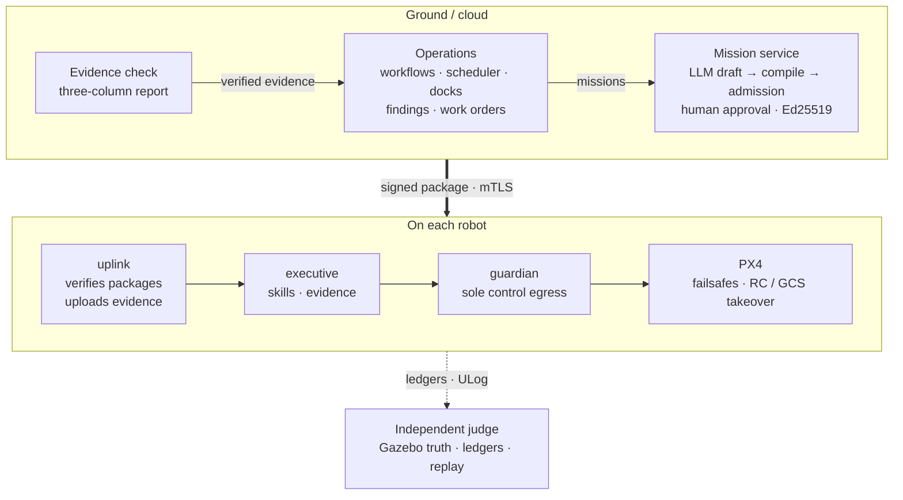

# drone-agent

**Natural-language missions. Deterministic execution. Verifiable outcomes.**

**English** | [中文](README.zh-CN.md)

[](https://github.com/SuperdeMan/drone-agent/actions/workflows/checks.yml)
[](pyproject.toml)
[](docs/roadmap.md)
[](LICENSE)

drone-agent is a drone inspection operations platform built on a safety-constrained mission runtime. An operator asks for an inspection in plain language. A language model drafts a typed mission, deterministic code compiles and admits it, and a person approves and signs the exact package. On board, a `guardian` process, the only holder of the flight-controller link, checks every control write. Around this runtime the platform manages sites and docks, durable workflows, multi-aircraft scheduling, findings, work orders and reinspection, and it hands ground rechecks over to a rover.

> **Status (2026-10-22): software only, validated in simulation.** Release gates have passed for the single-drone runtime (M0–M2), local autonomy (M3-SITL), the hardware-free platform v0.1 (P0–P5), six of the seven P6 work packages and the first air-ground simulation (X1-01). They ran in PX4 SITL + Gazebo, logical fleets and a vendor protocol simulator. No real aircraft, dock or vendor firmware has been connected; hardware validation is a separate track (H1–H3).

> **P6 road evaluation remains open.** Public UAV collection and owner-authorized independent AI annotation and verification have produced reference material; independent asset coverage, verified repeat pairs and the formal model evaluation remain pending. Human review timing is deferred to operational validation. See the [current P6 handoff](docs/p6-road-corpus-handoff-2026-10-22.md) for exact evidence and remaining work.

<p align="center">
  
</p>
<p align="center"><sub>The operations desk (UI in Chinese) in a local preview over the logical world. A mission from the scheduler waits for approval: the signature binds to the package's SHA-256, every admission check is listed, and provenance labels say what actually ran (here logical flights and deterministic planning). An illustration, not validation evidence.</sub></p>

[Highlights](#highlights) · [Capabilities](#capabilities-and-evidence) · [Architecture](#architecture) · [Try it](#try-it) · [Validation](#how-results-are-validated) · [Limits](#limits) · [Roadmap](#roadmap) · [Docs](#documentation)

## Highlights

- **The model drafts; deterministic code decides.** Language models produce only typed drafts and candidate judgments: a `MissionSpec` draft, a workflow draft, a suspected finding, an explanation that cites facts. Compilation, admission, approval, control and recovery are deterministic. Text and images cannot grant a permission or reach the flight controller, and a contract test pins the onboard import graph so that onboard code never loads the planner or a model provider.
- **One control egress per robot.** Only `guardian` holds the flight-controller connection. Every write carries a lease epoch and a command sequence; stale epochs are rejected, and a timed-out command is reconciled before it is resent. PX4's native failsafes and RC / GCS takeover stay available, and there is no kill API.
- **Approval is bound to the bytes.** An Ed25519 signature covers the approved version and the package hash. Packages travel over mTLS, and `uplink`, `executive` and `guardian` each verify them again on board. Schedules, workflows, events and models can start a mission but never approve one. A person approves each package. The only automatic approval is an unchanged retry of a step whose last result was failed, unverified or unknown, at most twice per flight mission, and the new version takes over only after landing and disarming.
- **Evidence before success.** Execution status, effect verdict and safety verdict are recorded separately. `UNKNOWN` is never success, and "completed" means succeeded ∧ verified. A model's finding never changes a flight verdict, and a work order closes only on a new verified capture taken after the repair.
- **Operations that fail safe.** Workflows survive restarts through leases, fencing and an outbox. A cancel is a persisted intent that blocks further dispatch. Dock and airspace holds are released only on a terminal result plus fresh grounded evidence, never on a timeout, and a silent aircraft's envelope keeps growing until it is reconciled.
- **Evaluation is part of the product.** Independent judges read Gazebo truth and the ledgers, online and again on replay, and sort every run into completed, justified refusal, or unsafe / incorrect. Each release gate binds its results to one commit. Prompt and model changes are adopted only by pre-registered rules on held-out corpora, and failed candidates stay on record.

## Capabilities and evidence

S0 is a logical world, S1 is PX4 SITL + Gazebo, S2 is a live model on frozen, authorized images and S3 is a vendor protocol simulator. Each layer is counted separately, and every figure belongs to the commit shown.

| Area | What works | Evidence |
|---|---|---|
| **Mission runtime**<br>M0–M2 | Plain-language request → constrained draft (MiniMax-M3 with read-only tools) → `MissionSpec` → compilation and fail-closed admission (capability, space, time, energy, airspace, resources) → signed package over mTLS → `uplink`, `executive`, `guardian` → PX4 → three-column evidence report | [M1](docs/m1-readiness.md) `eefe76e`: 22 flight and fault scenarios × 3 seeds = 66/66, zero false success<br>[M2](docs/m2-readiness.md) `f362b9e`: end-to-end 18/18; 74 adversarial cases blocked or refused; live MiniMax-M3 admitted 20/20 plannable requests on the first attempt |
| **Local autonomy**<br>M3-SITL | ROS 2 Jazzy nodes plan short segments on depth maps. `guardian` filters every target through a control barrier function and authorizes it for 300 ms at a time; a PX4 external-mode node only forwards those authorizations. Energy reachability; onboard event detection yields candidates only | [M3-SITL](docs/m3-readiness.md) `75382dc`: 16 autonomy and fault scenarios × 3 seeds = 48/48; supervision period p99 ≤ 106.6 ms. Jetson-in-the-loop pending |
| **Sites, docks and dispatch**<br>P1 | Projects and roles. Docks report link, lid, slot, energy, environment and upkeep; one deterministic eligibility check and exclusive holds gate the preview, the lid opening and the moment the aircraft fetches its package | [P1](docs/p1-readiness.md) `b49701b`: S0 14 faults × 3 seeds = 42/42; S1 through a virtual dock 5/5 |
| **Durable workflows**<br>P2 | Versioned templates of whitelisted activities, started by hand, on a schedule or by an event. Restart-safe; the same activity never dispatches twice, and nothing new starts after a cancel | [P2](docs/p2-readiness.md) `3bdbd50`: S0 45/45; S1 5/5 |
| **Multi-site scheduling**<br>P3 | A replayable decision names the reason for every excluded robot. One transaction assigns the task and holds the robot, the dock and the airspace cells of its route; withdrawal before a claim and task-level relay | [P3](docs/p3-readiness.md) `73fcf23`: S0 45/45 plus a 10 / 30 / 100-node ladder; S1 with two aircraft in one Gazebo world 5/5 |
| **Findings to reinspection**<br>P4 | A quality layer and durable analysis jobs turn verified captures into candidate findings with labelled sources. A reviewer confirms; each finding gets one work order, which a reinspection closes only with new evidence | [P4](docs/p4-readiness.md) `8f41112`, S2 re-verified at `f4b1b99`: S0 45/45; S1 with a Gazebo damage patch 5/5; S2 on VisA close-ups with MiniMax-M3.1-Flash-Preview: precision 0.9703, recall 0.8167 |
| **Platform v0.1**<br>P5 | One resident desk over three execution backends (PX4 SITL, a logical fleet, a vendor protocol simulator), with a second business template, a vendor mission gateway and a project audit trail | [P5](docs/p5-readiness.md) `1716843`: 22/22 criteria, including a 72-hour wall-clock soak in which dock sessions recovered within 10.6 s after 9 restarts and 3 kills |
| **Evidence-driven operations**<br>P6 | Recapture, target-region quality, real-model adversarial recordings, safer planning prompts, a fact-checked mission explainer, trajectory-checked airspace holds, capacity and retention, an asset archive | [Six of seven work packages passed](#evidence-driven-operations-p6), 2026-10-10 to 10-13 |
| **Air-ground recheck**<br>X1-01 | An x500 and a PX4 rover share one Gazebo world. The aircraft finds an anomaly, the coordinator offers a ground recheck, and the rover answers from its own map. After a person approves, it drives at no more than 1.0 m/s, captures and disarms once still. The rover runs the same onboard `uplink`, `executive` and `guardian` | [X1](docs/x1-readiness.md) `75cfde6`: S0 13 cases × 3 seeds = 39/39; S1 5 × 3 = 15/15 |

Skills cover aerial takeoff, registered routes, image capture, asset inspection, return-home and landing, and ground navigation, recheck and return-home. Inspection uses registered observation routes in the [simulation scenes](configs/scenarios/). People and agents enter through the web operations desk and an A2A gateway that can submit tasks and query status but cannot approve or control.

### Evidence-driven operations (P6)

P6 follows an [external review](docs/research/external-review-2026-10-10.md) of the platform. Changes to prompts and check rules count only when a rule written before the run adopts them.

| Work package | What it adds | Commit | Result |
|---|---|---|---|
| [Active recapture](docs/p6-recapture-readiness.md) (WP-P6-02) | A quality profile for the asset's projected region. When a verified capture is refused for a reason another flight can change, the workflow flies the same pose once more, with its own approval | `ecee452` | S0 30/30; S1 5/5 |
| [Adversarial recordings](docs/p6-adversarial-readiness.md) (WP-P6-03) | 134 real-model answers to five adversarial corpora (planning, workflow drafts, operations ambiguity, and vision under two profiles), committed and replayed strictly in the tests | `8d69ae1` | Escapes 0 |
| [Planner clarification](docs/planner-clarification-readiness.md) and [binding](docs/planner-binding-readiness.md) (D080, D081) | planner-v2 asks the operator when a request does not single out its assets; planner-v3 names the robot's project, site and robot | `02694be`, `b4a17a3` | Wrong plans 19 → 5, then 12 → 4, on held-out corpora written by independent authors |
| [Cross-site reference check](docs/reference-check-readiness.md) (D082) | Before any model call, rejects a request that names another project, site, robot or dock | `4398938` | 0 false rejections, 17 caught, 5 missed |
| [Explanation assistant](docs/explain-readiness.md) (WP-P6-05) | The model answers from a fact table without tools; the answer is shown only if every citation and claim checks out, otherwise a deterministic summary | `76e7403` | 23/26 live answers shown; no fabrication shown |
| [Fine airspace reservations](docs/fine-reservations-readiness.md) (WP-P6-06) | The judge checks every airborne position against the cells its flight held; per-leg corridors evaluated | `6544a9a` | 0 violations; corridors not adopted |
| [Capacity and retention](docs/capacity-readiness.md) (WP-P6-07) | Tail latencies and backlogs through `capacity.get`; dock status archived after 7 days into verifiable gzip chunks | `a63f3ac` | Per-pass p95 8.0 → 9.0 ms at 16× history (control without it: 1148.5 ms) |
| [Asset archive](docs/asset-archive-readiness.md) (WP-P6-04) | Append-only asset revisions, observations and events tagged fact, decision or belief; comparisons list factors and never name a cause | `6249129` | S0 18/18 |
| [Explanation check v2](docs/explain-check-v2-readiness.md) (D086) | Counts approval or completion phrases as claims only where a clause asserts them | `7f7b97b` | Not adopted: 3 missed assertions, 1 allowed |
| Target-business evaluation set (WP-P6-01) | Drone imagery for one inspection business, split by asset, place and batch and frozen before any test | — | Open: not frozen ([plan](docs/operations-implementation.md)) |

## Architecture



| Boundary | Responsibility |
|---|---|
| Planning | The planner proposes a draft from read-only context; deterministic code builds the `MissionSpec`. Models have no control path. |
| Admission and approval | Validate the mission, bind approval to `package_hash` and deliver a signed `MissionPackage`. |
| Operations | Workflows, the scheduler and the business loop submit ordinary missions to the same service. They never approve or control a flight. |
| On board | `uplink` fetches packages and uploads events and evidence, so `executive` needs no network. `executive` schedules skills; `guardian` checks authority, freshness and constraints before each control write and owns recovery. |
| Verification and replay | Evidence is rechecked; `execution_status`, `effect_verdict` and `safety_verdict` stay separate; `UNKNOWN` never counts as success. |

The cloud sends an authorized mission and its limits, not a stream of control commands; if the link drops, the robot finishes or recovers under its own policy. See the [architecture overview](docs/architecture/00-overview.md), [contracts](docs/architecture/02-contracts.md), [safety model](docs/architecture/03-safety.md) and [operations layer](docs/architecture/09-operations.md).

## Try it

Prerequisites: **Python 3.12+**, **uv** and **Git**. Both local options run on Windows or Linux without PX4 or Gazebo.

```bash
git clone https://github.com/SuperdeMan/drone-agent.git
cd drone-agent
uv sync --group dev
```

### Plan and sign a mission

```bash
uv run python -m drone_agent.console.mission --local
```

Open **<http://127.0.0.1:8769>**, select `campus_training` and `asset_red`, then submit this exact example:

> Inspect the red equipment marker east of the pad and bring back a photo.

Review the plan and admission checks, then approve the package. **Local mode plans, admits and signs; no robot is connected and nothing flies.**

Without `MINIMAX_API_KEY`, the desk uses labelled scripted answers for the exact requests in the [M2 scenario set](configs/scenarios/m2_suite.yaml). With a key in the process environment, it uses live MiniMax-M3 planning. The page names its planner; key setup is in the [cloud development guide](docs/cloud-development.md).

### See every operations workspace

```bash
uv run python scripts/desk_preview.py --seed
```

Open <http://127.0.0.1:8770>. The preview runs the formal mission service and real onboard processes over the logical S0 world with the resident desk's catalogs. `--seed` creates a flown mission, a workflow run up to its candidate finding, a queued fleet task, a vendor-managed inspection and a mission awaiting approval. Flights are logical and labelled as such, and nothing in the preview is validation evidence.

<p align="center">
  
</p>
<p align="center"><sub>The overview workspace of the same preview: a mission awaiting approval, a workflow waiting for human review, a candidate finding, and a robot that cannot be dispatched, with the reason.</sub></p>

### Fly in simulation

Integration uses a configured Linux cloud workspace. After following the [setup guide](docs/cloud-development.md), inspect the target and retrieve the resident flight desk URL:

```bash
uv run python scripts/dev_stack.py target
uv run python scripts/dev_stack.py status
uv run python scripts/dev_stack.py desk-cloud --status
```

The resident flight desk serves the operations desk and the M1 fixed-inspection page at one private Tailscale origin. Approved missions fly in PX4 / Gazebo and produce evidence reports, which an independent judge checks online and on replay. See the [flight desk guide](docs/tailnet-desk.md) and the [operations guide](docs/operations-guide.md). PX4 SITL and Gazebo run on Linux, and native components need an ASCII repository path; the [simulation guide](sim/README.md) also documents the explicit local fallback.

## How results are validated

- **Layered environments.** S0 checks state machines, faults and scale; S1 checks the real flight stack; S2 checks a live model on frozen images; S3 checks vendor protocol handling. No layer stands in for another or for hardware.
- **Independent judges.** Judges read Gazebo truth, ULog, ledgers and evidence rather than the system's own verdict, and run online and again on replay. Must-be-zero counts include false success, duplicate dispatch, double ownership and flight after a cancel.
- **Fault matrices.** Every recovery-policy edge needs an injection scenario before it enters a production policy, and each matrix runs at seeds 7, 19 and 41.
- **One commit per gate.** A release gate (`scripts/verify_*.py`) checks the cloud checks, simulation runs, regressions and resident-desk receipts of one candidate. Its results never carry over to later commits.
- **Pre-registered model decisions.** Prompts, profiles and rules are frozen first, and held-out corpora are written by authors who never saw the prompts. A rule fixed before the run decides adoption; two changes evaluated this way were not adopted.
- **Negative results stay.** Failed candidates and voided runs remain in the readiness records and the append-only [baselines](eval/BASELINES.md): P4's first S2 test, P5's first candidate and four replaced X1 candidates among them.

<details>
<summary><b>All release records, newest first</b></summary>

Each record owns the full gate results, failures and limitations for the revision shown; historical results do not validate later commits.

| Record | Revision | Date | Recorded result |
|---|---|---|---|
| [Air-ground simulation (WP-X1-01, D088)](docs/x1-readiness.md) | `75cfde6` | 2026-10-15 | Linux 1749 checks passed. An x500 and a PX4 differential rover share one Gazebo world: the aircraft finds an anomaly, the coordinator offers a ground recheck to the named rover, the rover answers from its own map, parking state and battery, and after a person approves the ground mission it drives at no more than 1.0 m/s (capped in the flight controller and judged against Gazebo truth), faces the target, captures, returns and disarms once still. S0 13 cases × 3 seeds = 39/39 and S1 on PX4 SITL 5 cases × 3 seeds = 15/15 as expected, every must-be-zero count 0; P1–P6 S0, M1 66/66, M2 18/18, M3 48/48 and P3 S1 5/5 regressions passed on the same commit. Four earlier candidates were replaced after their S1 runs exposed problems. The resident desk is not connected; the ground recovery edges remain a draft. |
| [Asset archive (WP-P6-04, D087)](docs/asset-archive-readiness.md) | `6249129` | 2026-10-13 | Linux 1588 checks passed. Three append-only tables keep each asset's definitions by site-map digest, one observation per verified capture with its measured viewpoint, and every review, order, repair, settlement and reference as an event tagged fact, decision or belief. `assets.compare` lists the factors between two captures and never names a cause. S0 matrix E1–E6: 18 cases as expected. On the desk the live ledger was backfilled (1150 observations); comparing the latest capture with the September reference through the entry shows the same viewpoint on real PX4 SITL telemetry, an unchanged asset definition and 3 repairs in between. |
| [Explanation check v2 (D086)](docs/explain-check-v2-readiness.md) | `7f7b97b` | 2026-10-12 | Linux 1574 checks passed. Check v2 counts an approval, completion or reuse phrase as a claim only when its clause asserts it. Both held-out sets were written and labelled after the freeze by independent agents. On 120 labelled sentences v2 cut false flags from 58 to 30 but missed 3 assertions (the rule allowed 1) and fell one sentence short of halving the false flags. On 30 new questions answered live, neither version showed an unsupported claim and v2 blocked no correct answer (v1: 1). The pre-registered rule keeps v1. |
| [Capacity observability and data retention (WP-P6-07, D085)](docs/capacity-readiness.md) | `a63f3ac` | 2026-10-12 | Linux 1563 checks passed. A capacity migration adds one table and 25 indexes (approved). Dock status reports older than the retention period (7 days on the desk) move day by day into verifiable gzip chunks, and the service reports its pass, transaction, loop and API tail latencies and backlogs through `capacity.get`. On synthetic histories grown from the desk's 1291 missions to 16× (20656), the migrated service stays flat: per-pass p95 8.0 → 9.0 ms, refresh 6.1 → 5.9 ms per mission, audit list p95 22.1 → 25.4 ms; the control without the migration reaches 1148.5 ms per pass. The fourth pre-registered attempt passed: the first failed one criterion (fixed), the second and third were voided because the measuring laptop ran on battery and then slept. The desk ledger is migrated and archived (1.46 M rows, nothing overdue). |
| [Fine airspace reservations (WP-P6-06, D084)](docs/fine-reservations-readiness.md) | `6544a9a` | 2026-10-12 | Linux 1530 checks passed. The P3 judge now checks that every airborne position (Gazebo truth in S1) lies in a cell its own flight held at that moment: 0 violations under both models in the S0 matrix, the ladders, a long-route rung and P3 S1 (minimum margin about 3.3 m). Per-leg corridors are an opt-in v2 catalog model. On long routes they cut airspace-only waiting from 261 s to 52 s, but the pre-registered rule required the drop to exceed three times the noise of two box runs (211.1 s against 209.1 s), so corridors are not adopted and no catalog switches. A first comparison was voided because Windows throttled the unattended local runs. |
| [Operations explanation assistant (WP-P6-05, D083)](docs/explain-readiness.md) | `76e7403` | 2026-10-11 | Linux 1476 checks passed. The desk can explain a mission: the service builds a fact table from its records, the model (no tools) answers citing fact ids, and the answer is shown only after every citation, code, evidence id, version and claim of approval or completion is checked against the facts; otherwise a deterministic summary. A frozen corpus of 12 real mission states and 26 questions: 170 scripted doubles all as expected. One live MiniMax-M3 run: 23/26 answers passed the check, all citing the decisive fact; the 3 rejected were correct answers that mentioned approval or completion inside a negation or condition. No fabrication was shown. P1 S0, the authorization matrix and the page client tests pass. |
| [Cross-site reference check (D082)](docs/reference-check-readiness.md) | `4398938` | 2026-10-11 | Linux 1470 checks passed. Before planning, the service checks the request text against the catalog's ids, site map ids and an alias file; a request that names another project, site, robot or dock is rejected with `scope.foreign_reference`, without a model call. On the three labelled operations corpora and 15 desk cases: 0 false rejections, 17 caught, 5 missed (descriptions only, another volume, a foreign asset id). The first alias set rejected one request that must be planned and did not pass; the revised set was re-evaluated on the same data. P1 S0 42/42, authorization escapes 0. On the resident desk the request for "the red equipment marker at site A" from site B's drone is now rejected in 0.2 s. |
| [Planner binding (D081)](docs/planner-binding-readiness.md) | `b4a17a3` | 2026-10-11 | Linux 1462 checks passed. In catalog mode the planning request now names the robot's project, site and robot, and planner-v3 declines references to another one. On a second held-out corpus (38 cases) planner-v2 and planner-v3 each answered twice: wrong plans fell from 12 to 4 and over-refusals rose from 3 to 4; all 20 references to other projects, sites or robots were declined. The pre-registered rule adopted planner-v3. nl_v1 escapes stay 0; the P1 S0 and authorization matrices pass. The resident desk now plans with planner-v3. Cross-site substitution is reduced, not eliminated: it recurred once on the development set and once in a desk observation. |
| [Planner clarification (D080)](docs/planner-clarification-readiness.md) | `02694be` | 2026-10-11 | Linux 1450 checks passed. planner-v2 asks the operator instead of guessing when a request does not single out its assets. A held-out corpus (38 cases, written after the prompt was frozen by an author who never saw either prompt) was answered live twice by each prompt: wrong plans fell from 19 to 5 and over-refusals rose from 0 to 1, so the pre-registered rule adopted planner-v2. nl_v1 escapes stay 0. 222 recordings replay strictly. The resident desk now plans with planner-v2. Cross-site references to an asset whose colour and id also exist at the robot's own site still slip through. |
| [P6 adversarial recordings (D079)](docs/p6-adversarial-readiness.md) | `8d69ae1` | 2026-10-11 | Linux 1433 checks passed. Five live corpora, 134 recordings, all replayed strictly on the candidate and matching their live receipts; escapes 0. Planner (MiniMax-M3), operations corpus: 30 accepted, 5 wrong but admitted only behind the human approval, 3 stopped by the guards; two live rounds agreed case by case on 25/32 and 31/38. Vision: change-v3 followed no text in the image (1 false assurance); change-v6 rated 3 damaged markers captioned "passed" as normal, though an upscaled damaged control without text also fooled it (6 false assurances). P1 S0 42/42, P1 S1 5/5, authorization escapes 0. Through the desk entry the live planner now plans `road_north` and `asset_red_b`. |
| [P6 active recapture (D078)](docs/p6-recapture-readiness.md) | `ecee452` | 2026-10-10 | Linux 1411 checks passed. S0 30/30 (P6-F01–F10 × 3 seeds): 21 refusals were replaced by a completed recapture; 6 runs failed without a conclusion when the recapture was refused again or declined; the whole-frame control template read a shadow as suspected 3 times, the P6 template 0 times. PX4 SITL 5/5 in 9 flights: the glowing disc raised the target's bright-pixel share to 0.997–1.0 (limit 0.5), and the recapture after its removal was normal. Gazebo truth at the 9 captures: heading 1.9°–12.7° off the approach route (declared ±20°), reported position 0.02–0.09 m from truth (declared 0.35 m). P1–P5 S0, the authorization matrix and the P2 / P4 S1 regressions passed. The resident desk ran one recapture session through the tailnet entry. |
| [P4 S2 re-verification (D076)](docs/p4-readiness.md) | `f4b1b99` | 2026-10-10 | **Passed (P4 closed).** MiniMax-M3.1-Flash-Preview, change-v6 at τ 0.95: single live test on the VisA test split (disclosed second use, pre-registered before the run) with precision 0.9703, recall 0.8167 (MiniMax-M3: 0.8835 and 0.758), coverage 0.998 and false assurance 0; strict replay 640/640 on the candidate; P4 S0 45/45 and the P1 / P2 / P3 S0 matrices rerun by the gate; the other fourteen P4 criteria remain those of `8f41112`. The figures cover VisA close-ups only, not drone imagery. |
| [External review hardening (D075, D076)](docs/research/external-review-2026-10-10.md) | `45ba863` | 2026-10-10 | Linux 1356 checks passed. Airspace footprints now follow each skill's motion range, so external-mode tasks hold their whole task scope and recovery landing sites are covered, while a flight that cannot be bounded is refused a reservation; the energy model refuses a map whose landing sites leave its ground plane; the completion cache keys every generation option. Local S0 regressions all passed: P3 45/45 and the ladder 3/3, P1 42/42, P2 45/45, P4 45/45, P5 S0 + S3 60/60, and the authorization matrix with zero escapes; attempts stalled while the dev PC slept were voided and rerun. Two-aircraft P3 S1 5/5. M3-SITL energy scenarios 9/9 at three seeds. The resident desk was activated, and one scheduler task was flown with its airspace cells held and released; judge completed, no false success. S2 calibration split only: frozen change-v6 on MiniMax-M3.1-Flash-Preview reached precision 0.9495 and recall 0.783 at τ 0.95. |
| [P5 release gate](docs/p5-readiness.md) | `1716843` | 2026-10-09 | **Passed.** One resident desk serves a PX4 SITL site, a logical fleet and a simulated vendor-managed dock under one service, with a second business template, a vendor protocol contract and a project audit trail. 1327 Linux checks; S0 second template 24/24 and S3 vendor contract 36/36 with zero authorization escapes; S1 4/4 in 9 PX4 SITL flights; P1–P4 S0 and S1 and M2 18/18 regressions; the main scenario closed through one entry and a backup was restored in a drill. A 72-hour real wall-clock soak passed all seven criteria: after each of 9 service restarts and 3 kills the dock sessions answered within 10.6 s (limit 60 s). The first candidate `4c3de14` failed that recovery criterion (67.5 s, because the service refreshed every historical mission synchronously at start) and is kept as a negative record. |
| [Operations desk visual v2 (D074)](docs/desk-visual-v2-readiness.md) | `0094238` | 2026-10-09 | Deployed with the Figma MCP implementation, browser icon and explicit Light/Dark buttons in both headers. Defaults to light; saves the choice across reloads and M1/M2 navigation and synchronizes tabs, independently of the OS. Linux: 1327 passed, no failures/errors/skips; worktree and isolated archive: 1326 passed plus 1 existing Windows Unix-socket skip each; Ruff and 32/32 client tests passed. 50 standard browser checks and 28 theme checks passed with no overflow or script errors. Business scripts, service fields and gate states are unchanged; no new resident flight was started. |
| [Operations desk workspaces (D068)](docs/desk-workspaces-readiness.md) | `a0d12ff` | 2026-09-29 | 1263 Linux tests; every workspace rendered through the real Tailnet entry in Edge, light and dark, desktop and phone, with no console errors; live-planned missions submitted, approved and followed in the page to the independent judge; a watch run, a repair and its reinspection driven through the page. No gate status changes. |
| [P4 release gate](docs/p4-readiness.md) | `8f41112` | 2026-09-28 | **Not passed (S2 only); S2 re-verified at `f4b1b99`.** 1258 Linux tests; 15 business-loop faults × 3 seeds = 45/45 (S0) and the P1 / P2 / P3 S0 matrices; 5/5 PX4 SITL cases with 12 flights and a Gazebo damage patch (S1); P2 S1, P3 S1 and M2 18/18 regressions; resident desk migrated with a verified backup and a watch run analysed by the scripted fixture and live MiniMax-M3; all safety counts zero. The single live S2 test on VisA boards: precision 0.8835 < 0.90, recall 0.758, coverage 0.996, false assurance 0.017. |
| [P3 release gate](docs/p3-readiness.md) | `73fcf23` | 2026-09-27 | 1226 Linux tests; 15 scheduling faults × 3 seeds = 45/45 and a 10 / 30 / 100 logical-node ladder 3/3 (S0); 5/5 two-aircraft PX4 SITL cases with 9 flights in one world (S1) at a real-time factor ≥ 0.97; P1, P2 S0 and S1 and M2 18/18 regressions; double ownership, duplicate execution, lost tasks, conflicting holds, false success and stale-epoch effects all zero; resident desk migrated with a verified backup and a task scheduled, approved and flown through it. |
| [P2 release gate](docs/p2-readiness.md) | `3bdbd50` | 2026-09-26 | 1174 Linux tests; 15 workflow restart, deduplication and cancellation faults × 3 seeds = 45/45 (S0) plus the P1 S0 matrix 42/42; 5/5 PX4 SITL cases with 8 flights (S1); M2 18/18; duplicate dispatch, dispatch after cancel, false success, false work orders and lost runs all zero; resident desk migrated with a verified backup and a workflow run through to reinspection. |
| [P1 release gate](docs/p1-readiness.md) | `b49701b` | 2026-09-26 | 1102 Linux tests; 14 dock and dispatch faults × 3 seeds = 42/42 over three logical sites (S0); 5/5 PX4 SITL cases through a virtual dock (S1); M2 18/18; wrong / duplicate dispatch, wrong release, project escape and false success all zero; resident desk migrated with a verified backup. |
| [P0 release gate](docs/p0-readiness.md) | `de597d0` | 2026-09-25 | 1000 Linux tests; 18/18 scripted M2 E2E cases and source audits; MiniMax-M3 live completion and cancellation probes; authoritative flight-version receipts verified. |
| [M3-SITL release gate](docs/m3-readiness.md) | `75382dc` | 2026-09-25 | 983 tests; 16 local-autonomy and fault scenarios × 3 seeds = 48/48; M1 66/66, M2 18/18 and 6/6 over Zenoh; zero false success reports and matching replay; supervision period p99 ≤ 106.6 ms. Jetson-in-the-loop pending hardware, so the combined M3 gate remains not passed. |
| [M2 review and unified desk](docs/m2-review-2026-09-24.md) | `e8edf28` | 2026-09-24 | 833 Linux checks and 18/18 M2 E2E cases passed; evidence handling, post-cancellation retries and judge coverage fixed. Live-model and interactive checks are listed separately. |
| [Resident desk with live planning](docs/tailnet-desk-readiness.md) | `74984f9` | 2026-09-23 | Chinese and English requests planned, approved, flown and independently verified; a privacy-intrusive request refused. |
| [Live planner baseline](docs/verification/m2-baseline-2026-09-23.json) | `f362b9e` | 2026-09-23 | MiniMax-M3: 20/20 plannable requests admitted on the first attempt, 8/8 expected refusals, 4/4 required blocks. |
| [M2 release gate](docs/m2-readiness.md) | `f362b9e` | 2026-09-23 | 775 tests; 18/18 end-to-end cases; 66/66 M1 regression; 42 deterministic and 32 scripted adversarial cases blocked or refused; zero false success reports and matching flight replay. The end-to-end and adversarial runs used labelled scripted planner answers to test the execution chain; live model behaviour is in the baseline and resident-desk records, and the [machine-readable release result](docs/verification/m2-2026-09-23-release.json) links the M2 evidence together. |
| [M1 runtime](docs/m1-readiness.md) | `eefe76e` | 2026-09-20 | 400 tests; 22 flight/fault scenarios × 3 seeds = 66/66 passed; zero false success reports; matching replay. |

</details>

## Limits

- **Simulation only.** No real aircraft, dock, vendor firmware or work-order system is connected. Jetson-in-the-loop (H1), bench and restricted flights (H2) and field operations (H3) form a separate hardware track that simulation results do not unlock.
- **Docks and vendors.** Docks are logical simulators. Vendor-managed docks are tested only against a protocol simulator, and the vendor profile declares `verified_against_firmware: false`.
- **Airspace and energy.** Airspace admission has a recorded UOM backend and rejects real-mode missions without a filing; reservation cells are a simulation grid. Energy estimates are for simulation only.
- **Vision.** Analysis precision was measured on VisA circuit-board close-ups, not drone imagery; the drone-imagery evaluation set (WP-P6-01) is not frozen yet. Camera heading is declared rather than measured and was checked only against Gazebo truth.
- **Air-ground.** Handoff goes through the coordinator; robots do not hand tasks to each other directly. Nav2 is not integrated yet, the ground recovery edges are a draft, and the resident desk does not run the rover.
- **Platforms.** PX4 v1.17 with MAVSDK-Python 3.17.4 only; DJI and ArduPilot are not implemented.

## Roadmap

| Track | Stages | Status |
|---|---|---|
| Mission runtime | M0–M2 contracts, single-drone runtime and constrained agent · M3 local autonomy | M0–M2 complete in simulation; M3-SITL passed, and M3 closes after Jetson-in-the-loop (H1) |
| Operations | P0 provenance · P1 sites and docks · P2 workflows · P3 scheduling · P4 business loop · P5 platform v0.1 · P6 evidence-driven operations | P0–P5 complete for the software / SITL scope; P6 six of seven work packages complete, WP-P6-01 open |
| Hardware | H1 Jetson-in-the-loop · H2 bench and restricted flights · H3 field operations | Waiting for hardware |
| Extensions | X1 air-ground · X2 vendor hardware · X3 models and a shared kernel | X1-01 complete for the software / SITL scope; Nav2 and real ground platforms (X1-02), X2 and X3 are conditional |

See the [full roadmap and exit criteria](docs/roadmap.md).

## Repository layout

```text
src/drone_agent/   one package
  contracts/ runtime/ mission/ guardian/ adapters/
                   onboard: contracts, IPC and logs, executive, guardian, PX4 adapter
  planner/ providers/ admission/
                   planning with read-only tools, model providers, compiler and admission
  fleet/           mission service, catalogs, docks, workflows, scheduler, business loop, handoff
  console/ eval/ autonomy/
                   operations desk, simulators and judges, M3 autonomy protocol
ros2_ws/           ROS 2 Jazzy nodes for local autonomy (M3)
proto/             wire contracts drone.*.v1 with locked field numbers
configs/           platforms, skills, recovery policies, scenarios and operations catalogs
eval/              adversarial corpora and recordings, S2 manifests, append-only BASELINES.md
docs/              architecture, decisions D001–D090, readiness records, verification receipts
scripts/           dev_stack.py for the cloud workspace, release gates verify_*.py, desk tools
sim/               PX4 / Gazebo images and compose files per stage
tests/             mirrors src/; tests/contracts/ turn the red lines into executable tests
```

## Development

```bash
uv run ruff check .
uv run pytest -q
uv run python scripts/generate_contract_fields.py --check
uv run python scripts/generate_proto.py
```

Every push to `main` and every pull request runs ruff, the contract-field check, the full pytest suite and the console client tests ([checks](.github/workflows/checks.yml)); release gates still decide milestones on their own candidates. For dependency downloads through the project mirror, set `UV_DEFAULT_INDEX=https://pypi.tuna.tsinghua.edu.cn/simple` for the current command or terminal session. Contract and planning checks run directly on Windows; Linux builds and integration use `scripts/dev_stack.py`.

Read [CLAUDE.md](CLAUDE.md) before contributing ([AGENTS.md](AGENTS.md) is the coding-agent entry). Architecture and execution changes start with the design documents and an entry in the [decision log](docs/decisions.md). Design documents are in Chinese; the READMEs and code comments are bilingual.

## Documentation

| To learn about | Read |
|---|---|
| System boundaries and the document map | [Architecture overview](docs/architecture/00-overview.md) · [Layers](docs/architecture/01-layers.md) |
| Message semantics and runtime assurance | [Contracts](docs/architecture/02-contracts.md) · [Safety](docs/architecture/03-safety.md) · [Wire protocol](proto/README.md) |
| Resources, workflows, scheduling and the business loop | [Operations architecture](docs/architecture/09-operations.md) · [Implementation tasks](docs/operations-implementation.md) |
| Air-ground collaboration | [Air-ground architecture](docs/architecture/04-air-ground.md) · [X1 plan](docs/x1-implementation.md) · [X1 validation](docs/x1-readiness.md) |
| Running the platform | [Cloud development](docs/cloud-development.md) · [Flight desk](docs/tailnet-desk.md) · [Operations guide](docs/operations-guide.md) · [Simulation](sim/README.md) |
| Evidence, judges and replay | [Evaluation](docs/architecture/08-evaluation.md) · [Fetch and view a run](docs/cloud-development.md#查看与人工核对结果) · [Baselines](eval/BASELINES.md) |
| P6 public materials and remaining work | [Current handoff](docs/p6-road-corpus-handoff-2026-10-22.md) · [Business evaluation protocol](docs/p6-business-evaluation.md) · [Sources](docs/p6-materials-review.md) |
| Design rationale | [Decision log D001–D090](docs/decisions.md) · [Research and technology radar](docs/research/) · [Sibling-project reuse](docs/reuse-from-embodied-agent.md) |

## License

[Apache License 2.0](LICENSE).
