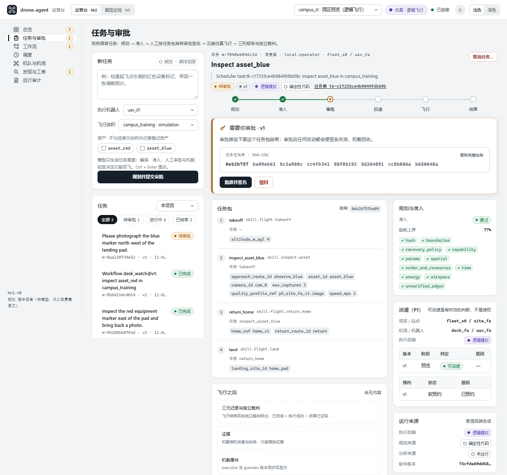
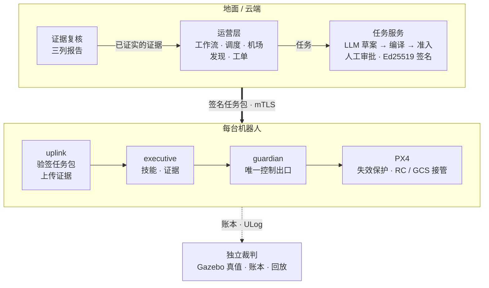
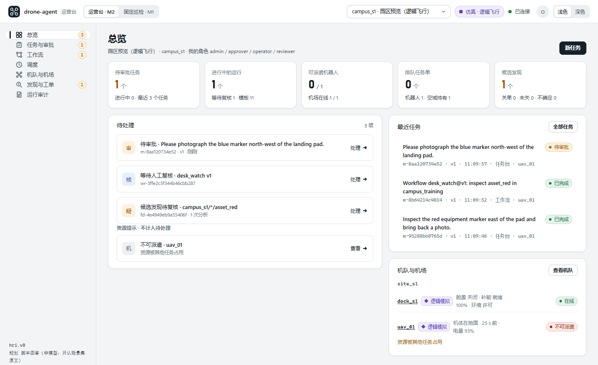

# drone-agent

**自然语言描述任务，确定性运行时执行，以证据确认结果。**

[English](README.md) | **中文**

[](https://github.com/SuperdeMan/drone-agent/actions/workflows/checks.yml)
[](pyproject.toml)
[](docs/roadmap.md)
[](LICENSE)

drone-agent 是以安全约束任务运行时为底座的无人机巡检运营平台。操作者用自然语言提出巡检要求；语言模型生成类型化的任务草案，确定性代码编译并准入，再由人批准并签名确切的任务包。机载的 `guardian` 进程是唯一持有飞控连接的进程，每一次控制写入都要经过它的检查。在这个运行时之上，平台管理站点与机场、持久工作流、多机调度、发现、工单与复检，并能把地面复核交给地面车。

> **当前状态（2026-10-22）：只有软件，全部在仿真中验证。** 单机运行时（M0–M2）、局部自主（M3-SITL）、无硬件平台 v0.1（P0–P5）、P6 七个工作包中的六个，以及首个空地联合仿真（X1-01）均已通过门禁。验证环境是 PX4 SITL + Gazebo、逻辑机队与厂商协议模拟器。尚未接入任何真实飞行器、机场或厂商固件；硬件验证是独立的 H1–H3 线。

> **P6 工程范围关闭检查中（D091）。** 用户已批准按评测工具与公开素材交付收口；完整道路业务验收移至[运营前验证](docs/road-business-validation-backlog.md)，当前尚未通过。准确状态见[工程验收](docs/p6-engineering-readiness.md)和[材料交接](docs/p6-road-corpus-handoff-2026-10-22.md)；真人复核效率与现场清障仍未验证。

<p align="center">
  
</p>
<p align="center"><sub>运营台在本机预览中的样子（S0 逻辑世界）。调度器分配的一个任务在等待审批：签名绑定任务包的 SHA-256，逐项列出准入检查，运行来源如实标注实际跑的是什么（此处为逻辑飞行与确定性规划）。只作示意，不是验证证据。</sub></p>

[设计亮点](#设计亮点) · [能力与证据](#能力与证据) · [架构](#架构) · [上手体验](#上手体验) · [验证方法](#结果如何验证) · [边界](#边界) · [路线图](#路线图) · [文档](#文档导航)

## 设计亮点

- **模型只出草案，确定性代码做决定。** 语言模型只产出类型化草案和候选判断：`MissionSpec` 草案、工作流草案、疑似发现、引用事实的解释。编译、准入、审批、控制与恢复都是确定性代码；文字和图片既不能授予权限，也触达不了飞控。契约测试钉住机载代码的导入图，机载进程不会加载规划器或模型 Provider。
- **每台机器人只有一个控制出口。** 只有 `guardian` 持有飞控连接。每次写入携带控制权代次（`lease_epoch`）与命令序号，旧代次一律拒绝，超时的命令先对账再重发。PX4 原生失效保护与 RC / GCS 接管始终可用，系统不提供空中断电（kill）接口。
- **审批绑定到字节。** Ed25519 签名覆盖已批准的版本与任务包哈希；任务包经 mTLS 下发，机载的 `uplink`、`executive`、`guardian` 各自再验签。排班、工作流、事件和模型都能发起任务，但都不能批准任务。每个任务包都由人批准；唯一的自动批准是对最近一次结果为失败、未证实或未知的步骤原样重试，每个飞行任务至多两次，且新版本只在落地上锁后接管。
- **证据先于成功。** 执行状态、效果判定、安全判定分开记录；`UNKNOWN` 永远不是成功，「已完成」只接受「执行成功 ∧ 效果已证实」。模型给出的发现从不改变飞行判定；工单只有在维修之后出现新的已证实采集时才能关单。
- **运营失败时偏向安全。** 工作流靠租约、fencing 与 outbox 跨越服务重启；取消是持久化的意图，写入后不再派遣后续任务。机场与空域的占用只在终态结果加新鲜的落地证据之后释放，从不按超时释放；失联飞行器的空间包络持续增长，直到对账完成。
- **评测是产品的一部分。** 独立裁判读取 Gazebo 真值与账本，在线与回放各跑一次，把每次运行归入「完成」「合理拒绝」「不安全或错误」三类之一。每个门禁的结果绑定唯一的提交；提示与模型的改动只按预登记规则、在留出语料上决定是否采用；失败的候选保留为负记录。

## 能力与证据

S0 是逻辑世界，S1 是 PX4 SITL + Gazebo，S2 是在冻结的授权素材上实调模型，S3 是厂商协议模拟器。各层分别计数，每个数字只属于所列的提交。

| 领域 | 已实现的能力 | 证据 |
|---|---|---|
| **任务运行时**<br>M0–M2 | 自然语言请求 → 受约束草案（MiniMax-M3，只读工具）→ `MissionSpec` → 编译与 fail-closed 准入（能力、空间、时间、能源、空域、资源）→ 签名任务包经 mTLS 下发 → `uplink`、`executive`、`guardian` → PX4 → 三列证据报告 | [M1](docs/m1-readiness.md) `eefe76e`：22 个飞行与故障场景 × 3 种子 = 66/66，错误成功 0<br>[M2](docs/m2-readiness.md) `f362b9e`：端到端 18/18；74 条对抗用例全部拦截或拒答；MiniMax-M3 实调时 20/20 可规划请求一次通过准入 |
| **局部自主**<br>M3-SITL | ROS 2 Jazzy 节点基于深度地图规划短时域片段；`guardian` 用控制屏障函数过滤每个目标，每次只授权 300 ms；PX4 外部模式节点只转发这些授权。能源可达性；机载事件检测只产生候选 | [M3-SITL](docs/m3-readiness.md) `75382dc`：16 个局部自主与故障场景 × 3 种子 = 48/48；监督周期 p99 ≤ 106.6 ms。Jetson-in-the-loop 待硬件 |
| **站点、机场与派遣**<br>P1 | 项目与角色。机场报告通信、舱盖、机位、补能、环境与运维；同一个确定性可派遣判定加独占预约，约束预览、开盖与飞行器拉取任务包的那一刻 | [P1](docs/p1-readiness.md) `b49701b`：S0 14 类故障 × 3 种子 = 42/42；S1 经虚拟机场 5/5 |
| **持久工作流**<br>P2 | 版本化白名单活动模板，可人工、按排班或由事件触发。重启不丢；同一活动不会重复派飞，取消之后不再开始新动作 | [P2](docs/p2-readiness.md) `3bdbd50`：S0 45/45；S1 5/5 |
| **多站多机调度**<br>P3 | 可重放的判定为每台被排除的机器人写明原因。同一事务完成分配，并持有机器人、机场与航线经过的空域单元；领取前撤回与任务级接力 | [P3](docs/p3-readiness.md) `73fcf23`：S0 45/45，另有 10 / 30 / 100 节点规模阶梯；S1 同一 Gazebo 世界两架飞行器 5/5 |
| **发现到复检**<br>P4 | 质量层与持久分析作业把已证实的采集变为带来源标注的候选发现。reviewer 确认；每个发现一张工单，复检只有拿到新证据才能关单 | [P4](docs/p4-readiness.md) `8f41112`，S2 在 `f4b1b99` 复验：S0 45/45；S1 在 Gazebo 中放置损伤贴片 5/5；S2 在 VisA 近拍素材上用 MiniMax-M3.1-Flash-Preview：精确率 0.9703、召回率 0.8167 |
| **平台 v0.1**<br>P5 | 一个常驻任务台服务三种执行后端（PX4 SITL、逻辑机队、厂商协议模拟器），带第二业务模板、厂商任务网关与项目审计 | [P5](docs/p5-readiness.md) `1716843`：二十二项门禁全部通过，含 72 小时真实墙钟长稳；9 次服务重启与 3 次强杀后，机场会话都在 10.6 s 内恢复 |
| **证据驱动运营**<br>P6 | 主动补拍、目标区域质量、真实模型对抗录制、更稳妥的规划提示、逐条核对引用的任务解释、按真实轨迹核对的空域持有、容量与数据保留、资产档案 | [七个工作包中六个已准出](#证据驱动运营p6)，2026-10-10 至 10-13 |
| **空地复核**<br>X1-01 | x500 与 PX4 地面车在同一 Gazebo 世界：飞行器发现异常物，协调器提议地面复核，地面车按自己的地图作答；人工批准后以不超过 1.0 m/s 行驶，采集后静止上锁。地面车运行同一套机载 `uplink`、`executive`、`guardian` | [X1](docs/x1-readiness.md) `75cfde6`：S0 13 个场景 × 3 种子 = 39/39；S1 5 × 3 = 15/15 |

已实现的技能覆盖空中的起飞、登记航线飞行、拍照、资产巡检、返航与降落，以及地面的导航、复核与返回。巡检使用[仿真场景](configs/scenarios/)中登记的观察航线。人通过 Web 运营台进入，Agent 通过 A2A 网关进入；A2A 只能提交任务与查询状态，不能审批或控制。

### 证据驱动运营（P6）

P6 来自对平台的一次[外部评审](docs/research/external-review-2026-10-10.md)。提示与核对规则的改动，只有运行前写定的规则判定采用才算数。

| 工作包 | 增加的能力 | 提交 | 结果 |
|---|---|---|---|
| [主动补拍](docs/p6-recapture-readiness.md)（WP-P6-02） | 按资产投影区域检查的质量画像；已证实的采集因再飞一次可以改变的原因被拒判时，工作流在同一拍摄位补拍一次，补拍仍需单独审批 | `ecee452` | S0 30/30；S1 5/5 |
| [对抗录制](docs/p6-adversarial-readiness.md)（WP-P6-03） | 五份对抗语料（规划、工作流草案、运营歧义、两个画像下的视觉）共 134 份真实模型回答，提交进仓库并在测试中严格回放 | `8d69ae1` | 越权 0 |
| [规划澄清](docs/planner-clarification-readiness.md)与[绑定身份](docs/planner-binding-readiness.md)（D080、D081） | planner-v2 在请求没有指明检查什么时请操作者澄清；planner-v3 在请求中写明机器人所属项目、站点与机器人 | `02694be`、`b4a17a3` | 在独立作者编写的留出语料上，错误计划 19 → 5，再 12 → 4 |
| [跨站点指代检查](docs/reference-check-readiness.md)（D082） | 调用模型之前，拒绝点名其他项目、站点、机器人或机场的请求 | `4398938` | 误拦 0、拦下 17、漏拦 5 |
| [运营解释助手](docs/explain-readiness.md)（WP-P6-05） | 模型无工具、只依据事实表作答；每处引用与说法都核对通过才展示，否则展示确定性摘要 | `76e7403` | 实调 23/26 展示；没有展示任何编造 |
| [精细空域预约](docs/fine-reservations-readiness.md)（WP-P6-06） | 裁判核对每个空中位置都落在本次飞行所持的单元内；评测航段走廊 | `6544a9a` | 违例 0；走廊未采用 |
| [容量与数据保留](docs/capacity-readiness.md)（WP-P6-07） | 经 `capacity.get` 报告尾延迟与积压；机场状态超过 7 天按日归档为可校验的 gzip 块 | `a63f3ac` | 历史增长到 16× 时每轮 p95 8.0 → 9.0 ms（不带迁移的对照组 1148.5 ms） |
| [资产档案](docs/asset-archive-readiness.md)（WP-P6-04） | 只追加的资产修订、观测与带 fact / decision / belief 标记的事件；比较只列因素、从不下归因结论 | `6249129` | S0 18/18 |
| [解释核对 v2](docs/explain-check-v2-readiness.md)（D086） | 只在分句确实断言时，才把关于批准或完成的措辞当作断言 | `7f7b97b` | 未采用：漏拦 3 句，上限 1 句 |
| 道路评测工程交付（WP-P6-01，D091） | 评测工具、331条独立AI二审参考及可追溯公开素材交接 | — | [工程检查待完成](docs/p6-engineering-readiness.md)；完整道路业务验收移交后续 |

## 架构



| 边界 | 职责 |
|---|---|
| 规划 | 规划器基于只读上下文提出草案，确定性代码构建 `MissionSpec`；模型没有任何控制路径。 |
| 准入与审批 | 检查任务，将审批绑定到 `package_hash`，投递已签名的 `MissionPackage`。 |
| 运营 | 工作流、调度器与业务闭环都只向同一个任务服务提交普通任务，从不审批或控制飞行。 |
| 机载 | `uplink` 拉取任务包、上传事件与证据，因此 `executive` 不需要网络。`executive` 调度技能；`guardian` 在每次控制写入前检查权限、新鲜度与约束，并独自负责恢复。 |
| 验证与回放 | 复核证据，分别记录 `execution_status`、`effect_verdict`、`safety_verdict`；`UNKNOWN` 永远不计为成功。 |

云端下发的是已授权任务及其边界，不是连续的控制命令；断链时机器人按自己的策略完成或恢复。详见[架构总览](docs/architecture/00-overview.md)、[契约](docs/architecture/02-contracts.md)、[安全体系](docs/architecture/03-safety.md)与[运营层](docs/architecture/09-operations.md)。

## 上手体验

需要 **Python 3.12+**、**uv** 和 **Git**。下面两种本机方式都支持 Windows 与 Linux，无需 PX4 或 Gazebo。

```bash
git clone https://github.com/SuperdeMan/drone-agent.git
cd drone-agent
uv sync --group dev
```

### 规划并签名一个任务

```bash
uv run python -m drone_agent.console.mission --local
```

打开 **<http://127.0.0.1:8769>**，选择 `campus_training` 和 `asset_red`，原样提交以下示例：

> 检查起飞点东侧的红色设备标记，带回一张清晰照片。

查看规划与准入结果，再批准任务包。**本机模式完成规划、准入与签名，没有连接机器人，不会起飞。**

未设置 `MINIMAX_API_KEY` 时，任务台对 [M2 场景集](configs/scenarios/m2_suite.yaml)中的请求原文使用带标注的脚本回答；进程环境中有 key 时，使用 MiniMax-M3 实调规划。页面会标明所用规划器，密钥配置见[云端开发指南](docs/cloud-development.md)。

### 查看全部运营工作区

```bash
uv run python scripts/desk_preview.py --seed
```

打开 <http://127.0.0.1:8770>。预览在 S0 逻辑世界上运行正式的任务服务与真实机载进程，使用常驻任务台同款目录。`--seed` 会造出一次飞完的任务、一个运行到候选发现的工作流、一个排队的机队任务单、一次厂商托管巡检和一个待审批的任务。飞行是逻辑的并如实标注，预览中的任何内容都不是验证证据。

<p align="center">
  
</p>
<p align="center"><sub>同一预览的总览工作区：一个待审批的任务、一个等待人工复核的工作流、一个候选发现，以及一台不可派遣的机器人和原因。</sub></p>

### 在仿真中飞行

联调使用已配置的 Linux 云端工作区。按[配置指南](docs/cloud-development.md)完成准备后，检查目标并获取常驻飞行台地址：

```bash
uv run python scripts/dev_stack.py target
uv run python scripts/dev_stack.py status
uv run python scripts/dev_stack.py desk-cloud --status
```

常驻飞行台在同一个 Tailscale 私网入口提供运营台与 M1 固定巡检页。批准的任务在 PX4 / Gazebo 中飞行并生成证据报告，由独立裁判在线与回放各核对一次。见[飞行台指南](docs/tailnet-desk.md)与[运维手册](docs/operations-guide.md)。PX4 SITL 与 Gazebo 在 Linux 中运行，原生组件需要 ASCII 仓库路径；[仿真指南](sim/README.md)另有显式启用本地仿真的方法。

## 结果如何验证

- **分层环境。** S0 验证状态机、故障与规模；S1 验证真实飞控软件栈；S2 在冻结素材上验证实调模型；S3 验证厂商协议处理。各层互不替代，也都不能替代硬件。
- **独立裁判。** 裁判读取 Gazebo 真值、ULog、账本与证据，不采信系统自报的判定，在线与回放各跑一次。必须为零的计数包括错误成功、重复派飞、双重所有权与取消后飞行。
- **故障矩阵。** 恢复策略图的每条边都要有对应的注入场景才能进入生产策略；每个矩阵以种子 7、19、41 运行。
- **一个门禁绑定一个提交。** 发布门禁（`scripts/verify_*.py`）核对同一候选的云端检查、仿真运行、回归与常驻任务台回执，结果从不转借给之后的提交。
- **模型决策预登记。** 提示、画像与规则先冻结，留出语料由没看过提示的作者编写，是否采用由运行前写定的规则决定；按此评测的改动中有两项未被采用。
- **负结果保留。** 失败的候选与作废的运行都留在验收记录与只追加的[基线](eval/BASELINES.md)中，包括 P4 的首次 S2 测试、P5 的首个候选与被替换的四个 X1 候选。

<details>
<summary><b>全部验收记录（新的在前）</b></summary>

每份记录对所列版本的完整门禁结果、失败与局限负责；历史结果不能作为后续提交的验证。

| 记录 | 版本 | 日期 | 已记录结果 |
|---|---|---|---|
| [空地联合仿真（WP-X1-01，D088）](docs/x1-readiness.md) | `75cfde6` | 2026-10-15 | Linux 1749 项检查通过。x500 与 PX4 差速地面车在同一 Gazebo 世界：飞行器发现异常物，协调器向点名的地面车提议地面复核，地面车按自己的地图、停放状态与电量作答；人工批准地面任务后以不超过 1.0 m/s 行驶（飞控限速，裁判按 Gazebo 真值核对），正对目标采集、返回、静止后上锁。S0 13 个场景 × 3 种子 = 39/39、PX4 SITL 上的 S1 5 个场景 × 3 种子 = 15/15 全部按预期，必须为零的计数全为 0；同一提交上的 P1–P6 S0、M1 66/66、M2 18/18、M3 48/48 与 P3 S1 5/5 回归通过。此前四个候选在 S1 中暴露问题后被替换。常驻任务台不接入，地面恢复边仍为草稿。 |
| [资产档案（WP-P6-04，D087）](docs/asset-archive-readiness.md) | `6249129` | 2026-10-13 | Linux 1588 项检查通过。三张只追加的表按站点地图摘要保存资产定义，每次已核验采集一条观测并实测视角，复核、工单、维修、结算与参考图都作为带 fact / decision / belief 标记的事件。`assets.compare` 只列出两次采集之间的因素，从不指明原因。S0 矩阵 E1–E6 共 18 例全部按预期。任务台真实账本已回填（1150 条观测）；经入口拿最新采集对比 9 月的参考图，在真实 PX4 SITL 遥测上视角一致、资产定义未变、期间 3 次维修。 |
| [解释核对 v2（D086）](docs/explain-check-v2-readiness.md) | `7f7b97b` | 2026-10-12 | Linux 1574 项检查通过。核对 v2 只在所在分句确实断言时，才把关于批准、完成或沿用的措辞当作断言。两组留出数据都在冻结后由独立代理编写与标注。在 120 句带标注的句子上，v2 把误拦从 58 句降到 30 句，但漏拦 3 句断言（规则上限 1 句），误拦也差一句没有减半。30 个新问题实调一次：两版都没有展示无支撑的说法，v2 没有误拦正确回答（v1 误拦 1 个）。按预登记规则保留 v1。 |
| [容量观测与数据保留（WP-P6-07，D085）](docs/capacity-readiness.md) | `a63f3ac` | 2026-10-12 | Linux 1563 项检查通过。容量迁移新增 1 张表与 25 个索引（经批准）：超过保留期（任务台 7 天）的机场状态报告按日移入可校验的 gzip 块；服务经 `capacity.get` 报告每轮处理、写事务、事件循环与接口的尾延迟和积压。合成历史从任务台的 1291 个任务增长到 16×（20656 个）时，带迁移的服务基本持平：每轮 p95 8.0 → 9.0 ms，每次刷新 6.1 → 5.9 ms，审计列表 p95 22.1 → 25.4 ms；不带迁移的对照组每轮 p95 达到 1148.5 ms。预登记的第四轮通过：第一轮一项判据不通过（已修），第二、三轮因测量用笔记本断电和睡眠作废。任务台账本已迁移并归档（146 万行，超期 0）。 |
| [精细空域预约（WP-P6-06，D084）](docs/fine-reservations-readiness.md) | `6544a9a` | 2026-10-12 | Linux 1530 项检查通过。P3 裁判新增核对：每个空中位置（S1 为 Gazebo 真值）都落在本次飞行当时所持的单元内；两种模型在 S0 矩阵、规模阶梯、长航线档与 P3 S1 中违例均为 0（最小余量约 3.3 m）。航段走廊是调度目录 v2 的可选模型；在长航线上把只因空域等待从 261 s 降到 52 s，但预登记规则要求降幅超过两次外包矩形运行之差的 3 倍（211.1 s，实际 209.1 s），因此不采用，现有目录不切换。首轮比较因 Windows 对无人值守的本机运行降速而作废。 |
| [运营解释助手（WP-P6-05，D083）](docs/explain-readiness.md) | `76e7403` | 2026-10-11 | Linux 1476 项检查通过。任务台可以解释任务：服务从记录生成事实表，模型（没有工具）引用事实 id 作答；只有每处引用、问题码、证据、版本以及关于审批和完成的说法都核对通过才展示，否则展示确定性摘要。冻结语料 12 个真实任务状态、26 个问题：170 个替身全部符合预期。MiniMax-M3 实调一次：23/26 通过核对，全部引用决定性事实；被拦下的 3 例回答本身正确，只是在否定或条件句里提到审批或完成。没有展示任何编造。P1 S0、授权矩阵与页面客户端测试通过。 |
| [跨站点指代检查（D082）](docs/reference-check-readiness.md) | `4398938` | 2026-10-11 | Linux 1470 项检查通过。规划前，服务按目录 id、站点地图 id 与别名文件检查请求文字；点名其他项目、站点、机器人或机场的请求以 `scope.foreign_reference` 拒绝，不调用模型。三份已标注运营语料与 15 条任务台用例上：误拦 0、拦下 17、漏拦 5（只靠描述、其他体积、外站资产 id）。第一版别名误拦 1 例未通过，修订后在同一批数据上复评。P1 S0 42/42，授权矩阵越权 0。常驻任务台上，站点 B 的飞机请求「站点 A 的红色设备标记」现在 0.2 s 内被拒绝。 |
| [绑定身份（D081）](docs/planner-binding-readiness.md) | `b4a17a3` | 2026-10-11 | Linux 1462 项检查通过。目录模式下，规划请求写明机器人所属的项目、站点与机器人；planner-v3 遇到指代别的项目、站点或机器人的请求就拒答。在第二份留出语料（38 例）上两个提示各实调两轮：错误计划 12 → 4，过度拒答 3 → 4；指代别处的 20 次全部拒答。按预登记规则采用 planner-v3。`nl_v1` 越权仍为 0；P1 S0 与授权矩阵通过；常驻任务台已改用 planner-v3。跨站点替换减少但没有消除：开发集与任务台观察中各出现一次。 |
| [规划澄清（D080）](docs/planner-clarification-readiness.md) | `02694be` | 2026-10-11 | Linux 1450 项检查通过。请求没有指明检查什么时，planner-v2 请操作者澄清，而不是自己挑一个。留出语料 38 例，在提示冻结后由没看过任一提示的作者编写，两个提示各实调两轮：错误计划 19 → 5，过度拒答 0 → 1，按预登记规则采用 planner-v2。`nl_v1` 越权仍为 0；222 份录制严格回放；常驻任务台已改用 planner-v2。被指代的资产若与本站资产同色同名，跨站点指代仍会漏过。 |
| [P6 对抗录制（D079）](docs/p6-adversarial-readiness.md) | `8d69ae1` | 2026-10-11 | Linux 1433 项检查通过。五份实调语料共 134 份录制，在候选上严格回放、与实调回执逐例一致；越权 0。规划模型（MiniMax-M3）在运营语料上可接受 30、只剩人工审批把关 5、被确定性防线拦下 3；两轮实调逐例一致 25/32 与 31/38。视觉：change-v3 没有听从图中文字（虚假放行 1）；change-v6 把 3 张写着「已通过」的损伤图判为正常，但不带文字、放大的损伤对照也骗过了它（虚假放行 6）。P1 S0 42/42，P1 S1 5/5，授权矩阵逃逸 0。经任务台入口，实调规划现在能规划 `road_north` 与 `asset_red_b`。 |
| [P6 主动补拍（D078）](docs/p6-recapture-readiness.md) | `ecee452` | 2026-10-10 | Linux 1411 项检查通过。S0 30/30（P6-F01–F10 × 3 种子）：21 个拒判由补拍接替并完成；补拍再次被拒或被拒绝审批的 6 个运行以失败结束、没有结论；整图画像的对照模板把阴影读成疑似 3 次，P6 模板 0 次。PX4 SITL 5/5，9 次飞行：发光圆片使目标亮像素占比达到 0.997–1.0（限值 0.5），移除后的补拍结果正常。9 次采集处的 Gazebo 真值：航向与进近航线相差 1.9°–12.7°（声明 ±20°），上报位置与真值相差 0.02–0.09 m（声明 0.35 m）。P1–P5 S0、授权矩阵与 P2 / P4 S1 回归通过；常驻任务台经 Tailnet 入口完成一次补拍会话。 |
| [P4 S2 复验（D076）](docs/p4-readiness.md) | `f4b1b99` | 2026-10-10 | **通过（P4 准出）。** MiniMax-M3.1-Flash-Preview，change-v6、τ 0.95：VisA 测试拆分上唯一一次实调测试（已披露第 2 次使用，运行前预登记）精确率 0.9703、召回率 0.8167（MiniMax-M3 为 0.8835 与 0.758）、覆盖率 0.998、虚假放行率 0；候选上严格回放 640/640；门禁当场重跑 P4 S0 45/45 与 P1 / P2 / P3 S0 矩阵；P4 其余十四项仍为 `8f41112` 的结果。这些数字只覆盖 VisA 近拍素材，不代表无人机影像。 |
| [外部评审加固（D075、D076）](docs/research/external-review-2026-10-10.md) | `45ba863` | 2026-10-10 | Linux 1356 项检查通过。空域航迹覆盖按每个技能的运动范围计算，外部模式任务占用整个任务范围、恢复可能改降的降落点也被覆盖，无法界定范围的飞行一律不予预约；能源模型拒绝降落点不在其地面平面的地图；补全缓存的键覆盖全部生成选项。本机 S0 回归全部通过：P3 45/45 与阶梯 3/3、P1 42/42、P2 45/45、P4 45/45、P5 S0 + S3 60/60，授权矩阵逃逸 0；开发机睡眠期间卡住的尝试记为作废并重跑。两机 P3 S1 5/5。M3-SITL 能源场景三个种子 9/9。常驻任务台已激活，并经调度器飞完一个任务单，空域单元按持有与对账释放；裁判 completed、错误成功 0。S2 只在校准拆分上：冻结的 MiniMax-M3.1-Flash-Preview change-v6 在 τ 0.95 时精确率 0.9495、召回率 0.783。 |
| [P5 发布门禁](docs/p5-readiness.md) | `1716843` | 2026-10-09 | **通过。** 一个常驻任务台在同一服务下运行 PX4 SITL 站点、逻辑机队与模拟的厂商托管机场，带第二业务模板、厂商协议合同与项目审计。Linux 1327 项检查；S0 第二模板 24/24 与 S3 厂商合同 36/36，授权矩阵逃逸 0；S1 4/4（9 次 PX4 SITL 飞行）；P1–P4 S0 与 S1 及 M2 18/18 回归；一入口主场景关单，备份恢复演练通过。72 小时真实墙钟长稳七条判据全部通过：9 次服务重启与 3 次强杀后，机场会话都在 10.6 s 内应答（限值 60 s）。首个候选 `4c3de14` 在这条恢复判据上未通过（67.5 s，原因是服务启动时同步刷新全部历史任务），保留为负记录。 |
| [运营台视觉 v2（D074）](docs/desk-visual-v2-readiness.md) | `0094238` | 2026-10-09 | 已部署 Figma MCP 实现、浏览器图标与两页页头的「浅色 / 深色」按钮；默认浅色，刷新与 M1 / M2 切换保留选择、标签页同步，不依赖系统主题。Linux 1327 项通过、无失败 / 错误 / 跳过；工作区及独立 archive 各 1326 项通过、1 项原有 Windows Unix socket 跳过；Ruff 与客户端 32/32 通过。50 项常规浏览器检查及 28 项主题检查均通过，无横向溢出或脚本错误；业务脚本、服务字段与门禁状态不变，未新发起常驻飞行。 |
| [运营台工作区（D068）](docs/desk-workspaces-readiness.md) | `a0d12ff` | 2026-09-29 | Linux 1263 项测试；经真实 Tailnet 入口在 Edge 中渲染全部工作区（浅色 / 深色、桌面 / 手机），控制台无报错；在页面中提交、批准并跟随实调规划的任务直到独立裁判；经页面走完一次巡检运行、维修反馈与复检。不改变任何门禁状态。 |
| [P4 发布门禁](docs/p4-readiness.md) | `8f41112` | 2026-09-28 | **未通过（仅 S2）；S2 在 `f4b1b99` 复验。** Linux 1258 项测试；15 类业务闭环故障 × 3 种子 = 45/45（S0）以及 P1 / P2 / P3 S0 矩阵；PX4 SITL 5/5、12 次飞行并在 Gazebo 中放置损伤贴片（S1）；P2 S1、P3 S1 与 M2 18/18 回归；常驻任务台账本带经校验备份完成迁移，一次巡检由脚本夹具与实调 MiniMax-M3 分析；所有安全计数为 0。VisA 电路板上唯一一次 S2 实调测试：精确率 0.8835 < 0.90，召回率 0.758，覆盖率 0.996，虚假放行率 0.017。 |
| [P3 发布门禁](docs/p3-readiness.md) | `73fcf23` | 2026-09-27 | Linux 1226 项测试；15 类调度故障 × 3 种子 = 45/45，另有 10 / 30 / 100 逻辑节点阶梯 3/3（S0）；同一世界两架 PX4 SITL 5/5、9 次飞行（S1），实时因子 ≥ 0.97；P1、P2 的 S0 与 S1 以及 M2 18/18 回归；双重所有权、重复执行、丢失任务、冲突持有、错误成功与旧代次效果均为 0；常驻任务台账本带经校验备份完成迁移，并经它调度、审批并飞完一个任务单。 |
| [P2 发布门禁](docs/p2-readiness.md) | `3bdbd50` | 2026-09-26 | Linux 1174 项测试；15 类工作流重启、去重与取消故障 × 3 种子 = 45/45（S0），另加 P1 S0 矩阵 42/42；PX4 SITL 5/5、8 次飞行（S1）；M2 18/18；重复派飞、取消后派遣、错误成功、错误工单与丢失运行均为 0；常驻任务台账本带经校验备份完成迁移，并跑通一条到复检的工作流。 |
| [P1 发布门禁](docs/p1-readiness.md) | `b49701b` | 2026-09-26 | Linux 1102 项测试；三站逻辑世界中 14 类机场与派遣故障 × 3 种子 = 42/42（S0）；PX4 SITL 经虚拟机场 5/5（S1）；M2 18/18；错误派遣、重复派遣、错误释放、项目越权与错误成功均为 0；常驻任务台账本带经校验备份完成迁移。 |
| [P0 发布门禁](docs/p0-readiness.md) | `de597d0` | 2026-09-25 | Linux 1000 项测试；脚本规划 M2 E2E 18/18 与来源审计通过；MiniMax-M3 实调正常 / 取消探针通过；权威飞行版本回执核对通过。 |
| [M3-SITL 发布门禁](docs/m3-readiness.md) | `75382dc` | 2026-09-25 | 983 项测试；16 个局部自主与故障场景 × 3 种子 = 48/48；M1 66/66、M2 18/18、Zenoh 下 6/6；错误成功报告 0，飞行回放一致；监督周期 p99 ≤ 106.6 ms。Jetson-in-the-loop 待硬件，因此 M3 总门禁仍未通过。 |
| [M2 评审与统一入口](docs/m2-review-2026-09-24.md) | `e8edf28` | 2026-09-24 | Linux 833 项测试、M2 E2E 18/18 通过；修复证据闭环、取消后自动重飞与裁判缺口；实调与入口交互范围单独列出。 |
| [常驻任务台实调](docs/tailnet-desk-readiness.md) | `74984f9` | 2026-09-23 | 中英文请求完成规划、审批、飞行与独立验证；隐私越界请求被拒答。 |
| [规划器实调基线](docs/verification/m2-baseline-2026-09-23.json) | `f362b9e` | 2026-09-23 | MiniMax-M3：20/20 可规划请求一次通过准入，8/8 应拒答请求正确拒答，4/4 应拦截请求未被准入。 |
| [M2 发布门禁](docs/m2-readiness.md) | `f362b9e` | 2026-09-23 | 775 项测试；端到端 18/18，M1 回归 66/66；42 条确定性与 32 条脚本规划对抗用例全部拦截或拒答；错误成功报告 0，飞行回放一致。端到端与对抗运行使用带标注的脚本规划回答，验证执行链路及其边界；真实模型行为记录在实调基线与常驻任务台验收中，[机器可读的发布结果](docs/verification/m2-2026-09-23-release.json)汇集了 M2 的验收依据。 |
| [M1 运行时](docs/m1-readiness.md) | `eefe76e` | 2026-09-20 | 400 项测试；22 个飞行 / 故障场景 × 3 个种子，66/66 通过；错误成功报告 0，回放一致。 |

</details>

## 边界

- **只有仿真。** 没有接入任何真实飞行器、机场、厂商固件或工单系统。Jetson-in-the-loop（H1）、台架与受限真机（H2）、现场运营（H3）是独立的硬件线，仿真结果不能替它们解锁。
- **机场与厂商。** 机场是逻辑模拟器；厂商托管机场只对协议模拟器验证过，厂商档案声明 `verified_against_firmware: false`。
- **空域与能源。** 空域准入有录制的 UOM 后端，真实模式下没有报备的任务会被拒绝；预约单元是仿真网格。能耗估计只用于仿真。
- **视觉。** 分析精确率只在 VisA 电路板近拍素材上测过，不代表无人机影像；无人机视角的评测集（WP-P6-01）尚未冻结。相机航向是声明值而不是测量值，只用 Gazebo 真值核对过。
- **空地协同。** 交接经协调器进行，机器人之间不直接交接任务；Nav2 尚未接入，地面恢复边仍为草稿，常驻任务台不运行地面车。
- **平台。** 只支持 PX4 v1.17 与 MAVSDK-Python 3.17.4；DJI 与 ArduPilot 尚未实现。

## 路线图

| 路线 | 阶段 | 状态 |
|---|---|---|
| 任务运行时 | M0–M2 契约、单机运行时与受约束 Agent · M3 局部自主 | M0–M2 已完成仿真验证；M3-SITL 已通过，M3 待 Jetson-in-the-loop（H1）后关闭 |
| 运营 | P0 来源 · P1 站点与机场 · P2 工作流 · P3 调度 · P4 业务闭环 · P5 平台 v0.1 · P6 证据驱动运营 | P0–P5 软件 / SITL 范围已完成；P6 七个工作包中六个已完成，WP-P6-01 进行中 |
| 硬件 | H1 Jetson-in-the-loop · H2 台架与受限真机 · H3 现场运营 | 等待硬件 |
| 扩展 | X1 空地协同 · X2 厂商真实接入 · X3 模型与公共内核 | X1-01 软件 / SITL 范围已完成；Nav2 与真实地面平台（X1-02）、X2、X3 条件满足后推进 |

详见[完整路线图与退出标准](docs/roadmap.md)。

## 仓库结构

```text
src/drone_agent/   单包
  contracts/ runtime/ mission/ guardian/ adapters/
                   机载：契约、IPC 与日志、executive、guardian、PX4 适配
  planner/ providers/ admission/
                   只读工具规划、模型 Provider、编译与准入
  fleet/           任务服务、目录、机场、工作流、调度、业务闭环、交接
  console/ eval/ autonomy/
                   运营台、模拟器与裁判、M3 自主层协议
ros2_ws/           M3 局部自主的 ROS 2 Jazzy 节点
proto/             进程间与车队契约 drone.*.v1，字段号锁定
configs/           平台、技能、恢复策略、场景与运营目录
eval/              对抗语料与录制、S2 清单、只追加的 BASELINES.md
docs/              架构、决策 D001–D091、验收记录、验证回执
scripts/           云端工作区入口 dev_stack.py、发布门禁 verify_*.py、任务台工具
sim/               按阶段的 PX4 / Gazebo 镜像与 compose
tests/             镜像 src/；tests/contracts/ 把红线写成可执行的测试
```

## 开发

```bash
uv run ruff check .
uv run pytest -q
uv run python scripts/generate_contract_fields.py --check
uv run python scripts/generate_proto.py
```

每次推送到 `main` 与每个 PR 都会运行 ruff、契约字段核对、全量 pytest 与任务台客户端测试（[checks](.github/workflows/checks.yml)）；里程碑仍只由发布门禁在各自的候选上判定。通过项目镜像下载依赖时，为当前命令或终端会话设置 `UV_DEFAULT_INDEX=https://pypi.tuna.tsinghua.edu.cn/simple`。契约与规划检查可直接在 Windows 运行；Linux 构建与联调使用 `scripts/dev_stack.py`。

贡献前请阅读 [CLAUDE.md](CLAUDE.md)（AI 编码代理入口为 [AGENTS.md](AGENTS.md)）。架构与执行语义变更先修改设计文档，并在[决策记录](docs/decisions.md)中增加条目。设计文档使用中文，README 和代码注释保持中英双语。

## 文档导航

| 想了解 | 阅读入口 |
|---|---|
| 系统边界与完整文档地图 | [架构总览](docs/architecture/00-overview.md) · [分层](docs/architecture/01-layers.md) |
| 消息语义与运行时保障 | [契约](docs/architecture/02-contracts.md) · [安全体系](docs/architecture/03-safety.md) · [Wire 协议](proto/README.md) |
| 资源、工作流、调度与业务闭环 | [运营架构](docs/architecture/09-operations.md) · [实施任务](docs/operations-implementation.md) |
| 空地协同 | [空地协同架构](docs/architecture/04-air-ground.md) · [X1 实施方案](docs/x1-implementation.md) · [X1 验收](docs/x1-readiness.md) |
| 运行平台 | [云端开发](docs/cloud-development.md) · [飞行台](docs/tailnet-desk.md) · [运维手册](docs/operations-guide.md) · [仿真](sim/README.md) |
| 证据、裁判与回放 | [评测体系](docs/architecture/08-evaluation.md) · [拉取与查看运行](docs/cloud-development.md#查看与人工核对结果) · [基线](eval/BASELINES.md) |
| P6 公开材料与剩余工作 | [当前交接](docs/p6-road-corpus-handoff-2026-10-22.md) · [业务评测协议](docs/p6-business-evaluation.md) · [来源审查](docs/p6-materials-review.md) |
| 设计理由 | [决策记录 D001–D091](docs/decisions.md) · [调研与技术雷达](docs/research/) · [姊妹项目复用](docs/reuse-from-embodied-agent.md) |

## 许可证

[Apache License 2.0](LICENSE)。
