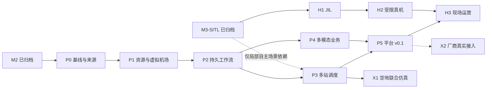

# drone-agent 路线图

[架构](architecture/00-overview.md) · [运营层设计](architecture/09-operations.md) · [全部实施任务](operations-implementation.md) · [P2 详细方案](p2-implementation.md) · [P3 详细方案](p3-implementation.md) · [P4 详细方案](p4-implementation.md) · [P5 详细方案](p5-implementation.md) · [X1 实施方案](x1-implementation.md) · [修订依据](research/operations-roadmap-review-2026-09-25.md)

**2026-09-25 修订（D049–D053）：软件运营主线 P0–P5、硬件验证线 H1–H3、扩展线 X1–X3 分开推进。** 近期交付无硬件也可验证的园区巡检运营平台：授权目标 → 资源准备 → 工作流 → 飞行取证 → 分析复核 → 工单 → 复检。既有安全运行时继续作为执行底座。

按退出证据推进，估算不作为准出依据。P1、P2 和预置航线的 P3 可复用 M2 `mission_upload`，不等待 Jetson；用到局部自主的场景才依赖相应候选的 M3-SITL。所有表中“目标”均为待实现验收条件。

## 1. 当前事实与历史里程碑

| 阶段 / 能力 | 准确状态 | 证据边界 |
|---|---|---|
| M0 | 2026-09-19 完成 | 契约、proto、环境冒烟；258 项测试，[记录](m0-readiness.md) |
| M1 | 2026-09-20 完成，单机仿真 | `eefe76e`，400 项测试、66/66 场景、14 恢复边，[记录](m1-readiness.md) |
| M2 | 2026-09-23 完成，受约束 Agent 仿真闭环 | `f362b9e`，775 项测试、E2E 18/18、M1 66/66；MiniMax-M3 实调基线独立记录，[记录](m2-readiness.md) |
| M3-SITL | 2026-09-25 已通过 | `75382dc`，983 项测试、M3 48/48、M1 66/66、M2 18/18、Zenoh 6/6；周期 p99 ≤106.6 ms，[记录](m3-readiness.md) |
| 原 M3 组合门禁 | **未关闭** | `m3_sitl=passed`，`jil=missing`，总状态 `not_passed`；H1 承接未完成 JIL，未降低门槛 |
| P0 | 2026-09-25 完成，软件 / SITL 范围 | `de597d0`：1000 项云端检查、18/18 E2E、18 份来源视图与两次 MiniMax-M3 实调探针，七项门禁全通过；[记录](p0-readiness.md) |
| P1 | 2026-09-26 完成，软件 / SITL 范围 | `b49701b`：1102 项云端检查；S0 故障矩阵 42/42（3 站 / 3 逻辑机场 / 3 逻辑 UAV，P1-F01–F14 × 3 种子）；S1 5/5（PX4 SITL 上的 `uav_01` 经虚拟机场）；M2 18/18；常驻任务台带 P1 目录与已迁移账本；九项门禁全通过，[记录](p1-readiness.md) |
| P2 | 2026-09-26 完成，软件 / SITL 范围 | `3bdbd50`：1174 项云端检查；S0 故障矩阵 45/45（P2-F01–F15 × 3 种子）与 P1 S0 回归 42/42；S1 5/5（PX4 SITL 上的 `uav_01` 经虚拟机场，8 次飞行，含 3 条到模拟工单与复检的业务链）；M2 18/18；常驻任务台带工作流目录与已迁移账本；十项门禁全通过，[记录](p2-readiness.md) |
| P3 | 2026-09-27 完成，软件 / SITL 范围 | `73fcf23`：1226 项云端检查；S0 故障矩阵 45/45 与 10 / 30 / 100 逻辑节点阶梯 3/3；S1 5/5（同一 Gazebo 世界两架 PX4 SITL，9 次飞行）；P1 / P2 回归与 M2 18/18；常驻任务台带调度目录与已迁移账本；十四项门禁全通过，[记录](p3-readiness.md) |
| P4 | 已完成（2026-10-10；`8f41112` + S2 复验 `f4b1b99`） | 业务闭环在 S0 / S1 / 常驻任务台成立（`8f41112`）；S2 首次实调测试精确率 0.8835 未达 0.90，按 D076 以 MiniMax-M3.1-Flash-Preview（change-v6）在已披露第 2 次使用的测试拆分上复验通过：精确率 0.9703、召回率 0.8167，S2 复验门禁七项全部通过，见 [P4 记录](p4-readiness.md) |
| P5 | 2026-10-09 完成，软件 / SITL / 协议模拟范围 | `1716843`：1327 项云端检查；S0 第二模板 24/24 与 S3 厂商合同 36/36，授权矩阵逃逸 0；S1 4/4（9 次 PX4 SITL 飞行）；P1–P4 S0 与 S1 回归、M2 18/18；常驻任务台（平台 v0.1）激活、一入口主场景关单、备份恢复演练；72 h 真实墙钟长稳七条判据全部通过（9 次服务重启与 3 次强杀后机场会话 ≤ 10.6 s 全部恢复）；二十二项门禁全通过，[记录](p5-readiness.md)。首个候选 `4c3de14` 的长稳恢复判据未通过（67.5 s），保留为负记录 |
| P6 WP-P6-01 工程交付（D091） | 2026-10-22 完成，仅工程范围 | `900abf1`：完整CI及工程门禁11/11通过；331条参考和材料交接；完整D089道路业务效果移交后续且未通过，见[工程验收](p6-engineering-readiness.md) |
| P6 WP-P6-02 | 2026-10-10 完成，软件 / SITL 范围 | `ecee452`：1411 项云端检查；S0 30/30（P6-F01–F10 × 3 种子）；S1 5/5（9 次 PX4 SITL 飞行，Gazebo 发光圆片）；P1–P5 S0、授权矩阵与 P2 / P4 S1 回归；常驻任务台激活到 `p6_desk_v1` 并完成一次补拍会话；十五项门禁全通过，[记录](p6-recapture-readiness.md)。航向为声明值，只用 Gazebo 真值核对过 |
| P6 WP-P6-03 | 2026-10-11 完成，软件 / SITL 范围 | `8d69ae1`：1433 项云端检查；五份语料（规划、工作流草案、运营规划、视觉 × 2 画像）134 份真实模型录制，严格回放逐例复现，越权 0；P1 S0 / S1、授权矩阵回归；任务台按站点实调规划核对；十四项门禁全通过，[记录](p6-adversarial-readiness.md)。模型行为只报告，不设阈值 |
| P6 规划澄清（D080） | 2026-10-11 采用，软件 / SITL 范围 | `02694be`：1450 项云端检查；独立作者编写的留出语料 `plan_ops_v2` 上，planner-v1 / v2 各实调两轮，错误计划 19 → 5、过度拒答 0 → 1，按预登记规则采用 planner-v2；`nl_v1` 越权 0；222 份录制严格回放；常驻任务台切换并经入口实调规划核对；八项门禁全通过，[记录](planner-clarification-readiness.md) |
| P6 绑定身份（D081） | 2026-10-11 采用，软件 / SITL 范围 | `b4a17a3`：1462 项云端检查；规划请求写明项目、站点与机器人（planner-v3）；独立作者的留出语料 `plan_ops_v3` 上 planner-v2 / v3 各实调两轮，错误计划 12 → 4、过度拒答 3 → 4，跨项目指代 20/20 拒答，按预登记规则采用；`nl_v1` 越权 0；P1 S0 与授权矩阵回归；常驻任务台切换；九项门禁全通过，[记录](planner-binding-readiness.md)。跨站点替换仍有残余（开发集与任务台各一次） |
| P6 跨站点指代检查（D082） | 2026-10-11 准出，软件 / SITL 范围 | `4398938`：1470 项云端检查；规划前按目录 id、站点地图 id 与别名检查请求文字，点名本任务以外的项目、站点、机器人或机场即以 `scope.foreign_reference` 拒绝；三份已标注语料与任务台用例上误拦 0、拦下 17、漏拦 5（第一版别名误拦 1 例未通过，修订后同数据复评）；P1 S0 与授权矩阵回归；任务台经入口拒绝跨站点请求；六项门禁全通过，[记录](reference-check-readiness.md) |
| P6 WP-P6-05 运营解释助手（D083） | 2026-10-11 准出，软件 / SITL 范围 | `76e7403`：1476 项云端检查；只读事实表、模型无工具回答并逐条引用、服务核对后才展示（否则确定性摘要）；冻结语料 12 个状态 26 例，170 个替身全部符合预期；MiniMax-M3 实调 23/26 通过核对、展示的编造 0（3 例为否定 / 条件句的误拦）；P1 S0、授权矩阵与页面客户端测试回归；任务台经入口解释核对；九项门禁全通过，[记录](explain-readiness.md) |
| P6 WP-P6-06 精细空域预约（D084） | 2026-10-12 准出，软件 / SITL 范围；走廊不采用 | `6544a9a`：1530 项云端检查；调度目录 v2 可选航段走廊（含恢复扇区），P3 裁判按真值核对空中位置落在所持单元内；按预登记规则比较：长航线档只因空域等待 261 → 52 s（−80%）、排空 −7%，但降幅 209.1 s 未超过 3 倍噪声 211.1 s，走廊不采用；两种模型在 S0 矩阵、阶梯、长航线档与 P3 S1 中轨迹违例 0（S1 最小余量约 3.3 m）；第一轮因开发机后台降速（EcoQoS）作废并披露；门禁八项全部通过，[记录](fine-reservations-readiness.md) |
| P6 WP-P6-07 容量观测与数据保留（D085） | 2026-10-12 准出，软件 / SITL 范围；新增 1 张表与 25 个索引（用户批准） | `a63f3ac`：1563 项云端检查；容量迁移（19 个基础索引、6 个后置索引与归档清单）、机场状态按日归档、容量指标与 `capacity.get`；合成历史规模阶梯 1× / 4× / 16×（1291 → 20656 个任务）第四轮按预登记判据通过：16× 每轮 p95 9.0 ms（1× 8.0 ms），每次刷新 5.9 ms，审计列表 p95 25.4 ms，不带迁移的对照组 16× 每轮 p95 1148.5 ms；前三轮一轮不通过（归档读穿稀疏行，已修）、两轮因本机断电或睡眠作废；任务台真实账本迁移，归档 145.7 万行、超期 0；门禁十项全部通过，[记录](capacity-readiness.md) |
| P6 解释核对 v2（D086） | 2026-10-12 评测完成，按预登记规则不采用 | `7f7b97b`：1574 项云端检查（实调在预登记版本 `d4ba149` 上）。v2 只在所在分句确实断言时，才把「已批准 / 已完成 / 沿用审批」当作断言。独立作者的留出句子 120 句上误拦 58 → 30，但漏拦 3（上限 1），误拦也差一句未达一半；30 个新问题实调并独立标注，两版逃逸 0，误拦 1 → 0。服务继续用 v1；门禁十二项全部通过，[记录](explain-check-v2-readiness.md) |
| P6 WP-P6-04 资产时空证据档案（D087） | 2026-10-13 准出，软件 / SITL 范围；新增 3 张表与 4 个索引（用户批准） | `6249129`：1588 项云端检查；资产修订、观测与权威事件三张只追加的表，迁移时备份并回填，`assets.list / timeline / compare / maintenance`，`orders.repair` 可带结构化维修；比较只给因素（定义、视角、期间维修与复核、参考），模型推测单列、摘要不下结论；S0 E1–E6 18 例全部按预期，P1–P6 S0 与授权矩阵回归；任务台真实账本回填 1150 条观测，经入口对比参考图得出视角一致、定义未变、期间 3 次维修；第一个候选 `e3510f1` 因旧地图定义未知被替换；门禁七项全部通过，[记录](asset-archive-readiness.md) |
| X1 WP-X1-01 空地联合仿真（D088） | 2026-10-15 准出，软件 / SITL 范围；新增 3 张表（只在带 `--air-ground` 的账本上，用户批准） | `75cfde6`：1749 项云端检查；同一 Gazebo 世界中的 x500 与 PX4 差速地面车：空中发现异常物，协调器向点名的地面车提议地面复核，地面车按自己的地图、停放状态与电量作答，人工审批后以不超过 1.0 m/s 行驶（飞控限速、裁判按真值核对），正对目标采集、返回、静止后上锁；S0 39/39（13 场景 × 3 种子）与 S1 15/15（5 场景 × 3 种子）全部按预期，十项必须为零的计数全为 0；P1–P6 S0、授权矩阵与资产档案回归，M1 66/66、M2 18/18、M3 48/48 与 P3 S1 5/5 回归；常驻任务台不接入；此前四个候选在 S1 中暴露问题被替换；门禁十一项全部通过，[记录](x1-readiness.md)。地面恢复边仍为草稿 |
| H1–H3、X1-02、X2–X3 | 待对应条件 | 下表和任务计划定义未来交付，不代表已运行 |

M1/M2 的历史实施清单分别保留在 [M1](m1-implementation.md)、[M2](m2-implementation.md)；M3 的原工作包和 SITL/JIL 分项保留在 [M3](m3-implementation.md)。[M2 评审](m2-review-2026-09-24.md)、[固定入口](tailnet-console-readiness.md)、[任务台](tailnet-desk-readiness.md)均为各自版本的验收，不转借为 P 系列结果。原 M4–M6 的 2027 日历窗口退出活动排期，以本次依赖图与硬件条件为准。

## 2. 产品主线 P0–P5

| 阶段 | 目标与交付 | 硬退出标准 | 依赖 / 任务入口 |
|---|---|---|---|
| **P0 范围与证据基线** | 当前能力盘点、来源契约、旧任务映射、产品门禁 | 设计 / 实现 / 仿真 / 硬件状态明确；运行来源贯穿服务与证据；历史结果不回填；所需门禁按准确候选检查 | WP-P0-01–04 已完成；[验收](p0-readiness.md)，[任务](operations-implementation.md) |
| **P1 云端资源与虚拟机场** | Project / Site / Dock、设备能力与状态、可派遣判断、最小预约、资源入口 | 3 站 / 3 Dock / 3 逻辑 UAV；充电、维护、离线、过期、卡盖不错误派遣；失联占用不错误释放；单机 S1 正式链路通过 | 2026-09-26 完成（`b49701b`）；[P1 详细方案](p1-implementation.md)，[验收](p1-readiness.md) |
| **P2 持久工作流 v1** | 人工 / 定时 / 事件触发；版本化流程、持久状态、审批、取消、重启对账；分析 / 复核 / 模拟工单 | 巡检—分析—人工复核—模拟工单闭环；重启不丢任务；重复事件不重复派飞；取消后不派后继；未知收尾不算成功 | 2026-09-26 完成（`3bdbd50`）；[P2 详细方案](p2-implementation.md)，[验收](p2-readiness.md) |
| **P3 多站多机任务调度** | 硬约束过滤、确定性排序、任务所有权、时空预约、故障对账、任务级接力 | S0 10/30/100 逻辑节点阶梯；至少 2 台同世界 S1 ×3 种子；双重所有权、重复执行、丢任务、冲突预约、假成功均 0 | 2026-09-27 完成（`73fcf23`）；[P3 详细方案](p3-implementation.md)，[验收](p3-readiness.md)（D059–D061）；3 台 S1 为容量评估后扩展 |
| **P4 多模态业务闭环** | 授权素材、通用质量核验、行业分析插件、发现 / 复核 / 工单 / 复检；证据报告 | 冻结测试集与指标；live / recorded / scripted 分开；模型不改变安全 / 效果判定；图像指令无执行权；缺新证据不关单 | P2；WP-P4-01–06（D063–D066）；2026-10-10 完成（`8f41112`，S2 按 D076 在 `f4b1b99` 复验通过）；[P4 详细方案](p4-implementation.md)，[验收](p4-readiness.md) |
| **P5 无硬件平台 v0.1** | 五工作区集成；一条完整主场景 + 第二业务模板；厂商协议模拟与运维交付 | 72 h 真实墙钟长稳；排班、重启、断网、取消、权限与模型故障可对账；全链路版本 / 来源 / 证据可复算；S3 合同测试通过 | P3 + P4（P4 除 S2 外，D069）；WP-P5-01–05；2026-10-09 完成（`1716843`）；[P5 详细方案](p5-implementation.md)，[验收](p5-readiness.md)，[运维手册](operations-guide.md) |

P1/P2 可先做单机场纵向子集；P1 正式关闭仍需三站逻辑验证，P2 正式关闭仍需 P1 和单机 SITL 业务闭环。P3/P4 的准备性研究可提前，完成声明按各自门禁。

P6「证据驱动运营」是 P5 之后按 [2026-10-10 外部评审](research/external-review-2026-10-10.md)增加的七个工作包，各按自己的门禁准出，工作包与判据见[实施任务 §10](operations-implementation.md)，状态见 §1 与 §7。

图中历史门禁是能力起点；对后续改动的验收仍在新的同一候选上取得，不能借箭头继承旧 SHA 的测试成绩。周期和责任分工见[实施计划](operations-implementation.md)。

## 3. 硬件线 H1–H3

| 阶段 | 原工作承接 | 退出标准与依赖 |
|---|---|---|
| **H1 目标算力 / JIL** | M3-JIL、arm64 镜像、Jetson 拓扑、D040 重测、机载生成式 VLM 评估 | Jetson 上四类故障 ×3 种子、完整 M1 回归、真实延迟 / 热 / 资源竞争；独立配额满足预算；具体 JIL 门禁实现后才关闭。待硬件 |
| **H2 台架与受限真机** | M4-A 的 11 个工作包 | H1 与目标控制路径的同候选 SITL 准入；接管 / 飞控失效保护 / 伴飞计算机断电 / 串口断开按台架、系留、受限任务递进；首版仅 mission_upload |
| **H3 现场持续运营** | M5 的真实运行与业务交付 | P5 + H2；实际网络、能源、传感器、维护、机械动作、业务结果可验证；真实空地部分还要求 X1 与对应设备 |

H1/H2 的采购、系统变更和现场执行条件不因本次文档修订获得批准。无硬件不阻塞 P 线，P 线通过也不解锁真实设备。

## 4. 扩展线 X1–X3

| 分支 | 范围 | 进入条件 |
|---|---|---|
| **X1 空地协同** | 原 M4-B 联合仿真（WP-X1-01 已于 2026-10-15 在 SITL 准出）；之后接 Nav2 与真实地面平台 | P3 后复用目录 / 所有权 / 预约；补地面可通行性、SpatialAlignment、交接与双端证据。不是 P5 前置 |
| **X2 厂商与平台** | P5 的 S3 协议测试之后接真实 DJI 设备；ArduPilot 后续 | 逐设备 / 固件 / 协议能力协商与责任档案；不伪造 guardian 或 Offboard 能力 |
| **X3 研究与内核** | VLA/VLN、WorldPredictor、学习型 LocalPolicy、Pegasus/Isaac、合成数据与训练导出、agent-kernel | 回放 → 仿真 → 影子 → 有限接管；agent-kernel 仍按 D001 双场景契约验证触发；不阻塞 P5 |

## 5. 原里程碑与工作包映射

| 原项 | 新去向 | 保留 / 调整 |
|---|---|---|
| M0–M2 | 历史基线 | 保留验收与编号；作为新产品线底座 |
| M3-SITL：WP-M3-01–20 的仿真部分 | 独立能力门禁 | 已验证范围按 `75382dc`；每项实际落位见 M3 计划 |
| WP-M3-02 arm64、03 JIL、04/15/17/20 的 Jetson 部分 | H1 | 全部保留，具体映射见 [M3 计划](m3-implementation.md) |
| M4-A：WP-M4A-01–11 | H2 | 硬件、接管、空域、现场程序和真机裁判不删减 |
| WP-M4B-03 能力发现 | P1/P3 → X1 复用 | 先 UAV 资源目录，再扩地面本体 |
| WP-M4B-05 所有权 / 交接 | P3 通用所有权 → X1 空地交接 | 接收方可达性与空间对齐留 X1，接受不是转移 |
| WP-M4B-06 预约 | P1 最小独占 → P3 时空预约 → X1 复用 | 失联包络规则贯穿三阶段 |
| WP-M4B-01/02/04/07/08/09/10 | X1 | 同世界 rover、地面运行时、对齐、双端复核、多机裁判、空地基线、Nav2 |
| M5 真实运营 / 地面平台 | H3 + X1 | UAV 运营可独立验证；空地声明需地面链单独通过 |
| M6 多机调度 / 数据飞轮 / 第二厂商 | P3 / P4–P5 / P5(S3)+X2(真实) | 业务数据闭环前移；训练导出和学习策略仍 X3 |
| M6 公共内核 / VLA / 世界模型 | X3 | 原触发条件保留 |

[M4 原工作包](m4-implementation.md)继续承载 21 项详细内容，不再是活动排期中的整体 M4 门禁。`decisions.md` 的旧条目只追加替代关系，不改写当时的决定。

## 6. 验证层级与共同门槛

| 层级 | 证明什么 | 不能证明什么 |
|---|---|---|
| S0 逻辑设备 / 机场 | 状态机、工作流、幂等、预约、故障与规模趋势 | 真实飞行、机械动作、电池性能 |
| S1 PX4 SITL + Gazebo | 飞控软件与正式任务执行、恢复、证据、独立裁判 | 真机气动、无线环境、实际算力和接管 |
| S2 授权真实素材 + 模型 | 分析精度、检索 / 变化识别、拒判、耗时与成本 | 主动采集或实时飞行闭环 |
| S3 厂商协议模拟 | ACK、进度、错误、重连、兼容与任务网关 | 真实设备 / 固件符合协议的程度 |
| H 实物验证 | 对应硬件、场地、配置、版本下的行为 | 其他设备、现场与版本自动通过 |

模拟器进入同一正式服务、审批、事件和证据链，不能另做前端假成功通路。S0/S3 凭据和网络不能触达真实设备；来源标签由受信后端生成。任何 unknown 阻断相应后继，业务关单需要独立的新证据。

每个门禁绑定源码、场景、模型 / 提示、控制面、裁判和原始证据摘要。P5 的 72 h 指系统持续运营与按计划执行，不是连续飞行；加速排班测试单独记录。硬件线缺证据如实 missing，禁止把总门禁失败改名为通过。

## 7. 下一批实施入口

- [x] WP-P0-03：来源对象与贯穿服务 / 证据的记录，已按 `de597d0` 验收。
- [x] WP-P0-04：产品门禁与能力清单，保留历史 M3 子结论 / 总结论区分，已验收。
- [x] WP-P1-01 / 02：资源契约与持久化设计（D055、D056，schema 变更经用户批准）。
- [x] WP-P1-03–08：存储、单机场模拟、正式服务接入与单机 SITL 链，已按 `b49701b` 验收。
- [x] WP-P1-09–12：项目权限、资源入口、三站故障矩阵与准出，见 [P1 记录](p1-readiness.md)。
- [x] WP-P2-01–08：持久工作流 v1（D057、D058，schema 扩展经用户批准），已按 `3bdbd50` 验收，见 [P2 记录](p2-readiness.md)。
- [x] WP-P3-01–06：多站多机调度（D059–D061，调度表经用户批准），已按 `73fcf23` 验收，见 [P3 记录](p3-readiness.md)。
- [x] WP-P4-01–06：多模态业务闭环（D063–D066；业务存储 D064 经用户批准；S2 素材为 VisA 电路板子集、模型为 MiniMax-M3，均由用户选定）。已按 `8f41112` 实施与验证，门禁只有 s2 未通过（精确率 0.8835 < 0.90）；2026-10-10 按 D076 在 `f4b1b99` 上复验 S2 通过，P4 准出，见 [P4 记录](p4-readiness.md)。
- [x] WP-P5-01–05：无硬件平台 v0.1（D069–D073；不新增表），已按 `1716843` 验收，见 [P5 记录](p5-readiness.md)；首个候选 `4c3de14` 因长稳恢复判据未通过，保留为负记录。

- [x] 外部评审（2026-10-10）的契约加固（D075）：航迹覆盖按技能解析、外部模式任务预约整个任务范围、无法解析即拒绝；能源模型的地面平面前提；补全缓存键。逐项采纳与修正见[评审记录](research/external-review-2026-10-10.md)。
- [x] P4 S2 复验（D076）：MiniMax-M3.1-Flash-Preview 视觉档已接入，按预先写定的规则冻结 change-v6（τ 0.95，`45ba863`）；用户选定在原测试拆分上披露第 2 次使用并预登记（`1be48b4`）。唯一一次实调测试精确率 0.9703、召回率 0.8167，S2 复验门禁在 `f4b1b99` 上通过。
- [x] WP-P6-02 主动补拍与目标区域质量（D078；不新增表）：[实施方案](p6-implementation.md)于 2026-10-10 经用户批准，同日按 `ecee452` 验收，软件 / SITL 范围，见 [P6 补拍验收](p6-recapture-readiness.md)。航向是声明值，上真机前须在证据中加入姿态或在实际平台重新标定。
- [x] WP-P6-03 真实模型对抗录制（D079；不新增表）：2026-10-11 按 `8d69ae1` 验收，五份语料 134 份录制可严格回放，越权 0；同时修正规划器只用基础场景与规划提示含时刻两个缺陷，见 [P6 对抗录制验收](p6-adversarial-readiness.md)。
- [x] 规划澄清（D080，WP-P6-03 的接手项）：planner-v2 在请求没有指明检查什么时请操作者澄清；留出语料由没看过提示的独立作者在提示冻结后编写，按预登记规则于 2026-10-11 在 `02694be` 采用，见 [规划澄清验收](planner-clarification-readiness.md)。跨站点同名指代仍需在规划请求中加入绑定身份。
- [x] 规划请求写明绑定身份（D081）：planner-v3 看到项目、站点与机器人，按同一协议于 2026-10-11 在 `b4a17a3` 采用，见 [绑定身份验收](planner-binding-readiness.md)；残余的跨站点替换需服务端确定性检查（另立设计）。
- [x] 跨站点指代的确定性检查（D082）：规划前拒绝点名其他项目、站点、机器人或机场的请求，2026-10-11 在 `4398938` 准出，见 [检查验收](reference-check-readiness.md)；只靠描述的指代、其他体积与外站资产 id 仍由规划器与审批把关。
- [x] WP-P6-05 运营解释助手（D083；不新增表）：2026-10-11 按 `76e7403` 验收，只覆盖任务；核对规则 v2（否定与条件说法）与工作流 / 工单的解释留待后续，见 [解释助手验收](explain-readiness.md)。
- [x] WP-P6-06 精细空域预约（D084；不新增表）：2026-10-12 按 `6544a9a` 验收，真实轨迹核对与利用率指标落地；走廊按预登记规则不采用，现有目录不切换；时间维度与高度分层不做，见 [精细预约验收](fine-reservations-readiness.md)。
- [x] WP-P6-07 容量观测与数据保留（D085；新增 1 张表与 25 个索引，用户批准）：2026-10-12 按 `a63f3ac` 验收，规模阶梯第四轮通过，任务台账本迁移并按 7 天保留期归档；72 h 长稳与自动 VACUUM 不在本工作包，见 [容量验收](capacity-readiness.md)。
- [x] WP-P6-04 资产时空证据档案（D087；新增 3 张表与 4 个索引，用户批准）：2026-10-13 按 `6249129` 验收，档案只给因素、不下归因结论；证据仍不带姿态，视角由位置推出，见 [资产档案验收](asset-archive-readiness.md)。
- [x] 解释核对 v2（D086）：2026-10-12 评测完成，按预登记规则不采用，服务继续用 v1；v3 需要新的留出集，见 [v2 验收](explain-check-v2-readiness.md)。
- [x] WP-X1-01 空地联合仿真（D088；只在带 `--air-ground` 的账本上新增 3 张表，用户批准）：[实施方案](x1-implementation.md)于 2026-10-14 经用户批准，2026-10-15 按 `75cfde6` 验收，软件 / SITL 范围，见 [X1 验收](x1-readiness.md)。地面恢复边仍为草稿，常驻任务台不接入；MAVSDK v4 迁移后要重跑 X1 S1 与完整 M1 回归。
- [x] WP-P6-01已按D091工程范围关闭：`900abf1`完整CI及工程门禁11/11通过，见[工程验收](p6-engineering-readiness.md)。完整D089样本、真实跨次与正式模型质量移交[后续业务验收](road-business-validation-backlog.md)，尚未通过；331参考和19局部审核见[材料交接](p6-road-corpus-handoff-2026-10-22.md)。真人效率与现场清障未验证，授权云端清理已完成。
- [x] 持续检查（D077）：`.github/workflows/checks.yml` 在 main 推送与 PR 上跑 ruff、契约字段、全量 pytest 与客户端测试；不开分支保护。

P4 的 S2 已按 D076 复验通过；VisA 测试拆分已用两次，之后不再用于任何画像，目标道路业务识别能力由[后续D089业务验收](road-business-validation-backlog.md)验证。P6 补拍的接手项见 [P6 补拍验收](p6-recapture-readiness.md)，P5 的见 [P5 记录](p5-readiness.md)，P4 的见 [P4 记录](p4-readiness.md)，P3 的见 [P3 记录](p3-readiness.md)。每阶段更新入口、对应 readiness 和路线状态；只有实际运行才向 `eval/BASELINES.md` 追加结果。季度技术雷达继续保留。
